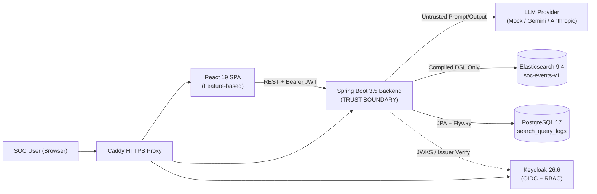

# Ngày 1: Business Domain, Kiến Trúc Tổng Thể (FE + BE) & Thiết Kế Dữ Liệu (`ES + PG`)

- **Thời lượng gợi ý:** 2.5 – 3 giờ
- **Tỷ trọng:** 70% Backend Java / Architecture / Data Design (ES & PostgreSQL) • 30% Frontend Architecture (React 19 / TypeScript)
- **Mục tiêu cuối ngày:** Trình bày trôi chảy bài Pitch 2 phút, vẽ được sơ đồ kiến trúc kèm **Trust Boundary**, giải thích rõ lý do chọn Modular Monolith, Feature-based Frontend, và cách thiết kế dữ liệu tách bạch giữa **Elasticsearch** và **PostgreSQL**.

---

## 1. Business Flow & Bức Tranh Toàn Cảnh

### Bài toán thực tế ở SOC (Security Operations Center)
- Khi có sự cố bảo mật (brute-force login, malware, privilege escalation, data exfiltration), SOC analyst phải truy vấn hàng trăm nghìn tới hàng triệu log sự kiện trong thời gian ngắn.
- **Điểm đau (Pain point):** Viết Elasticsearch DSL thủ công chậm, dễ sai cú pháp và khó đào tạo cho analyst mới (`SOC_VIEWER` / Tier-1). Nhưng nếu nối thẳng LLM vào cơ sở dữ liệu log để tự sinh Elasticsearch DSL sẽ mở ra hàng loạt lỗ hổng nghiêm trọng: **prompt injection, query phá cụm ES (wildcard/script nặng), rò rỉ dữ liệu thô, và mất dấu vết kiểm toán**.

### Kiến trúc & Trust Boundary

**Nguyên tắc cốt lõi:** Cả **Browser** lẫn **LLM** đều nằm **ngoài vùng tin cậy (untrusted)**. Backend là thành phần duy nhất được phép validate `SearchPlan`, compile ra Elasticsearch DSL, enforce RBAC, và ghi nhận audit.

---

## 2. Code Walkthrough Có Dẫn Đường (`FE → BE → DB`)

### A. Tầng Frontend Architecture (30%)
Mở đọc lần lượt 3 file sau để hiểu khung xương ứng dụng React:
1. [App.tsx](../../frontend/src/app/App.tsx)
   - Đóng vai trò **composition root**: đọc trạng thái đăng nhập từ `useSocAuth()`, tính các cờ quyền UX (`canUseHistory`, `canUseExport`, `canViewRawLog`, `canEditPlan`, `canUseAuditLogs`), kết nối các custom hooks (`useEventDetail`, `useSearchHistoryModal`, `useSearchExport`, `useSearchWorkflow`).
   - Dòng 52–58: Dùng `useEffect` đẩy `getAccessToken` & `refreshAccessToken` xuống module API client (`setAuthTokenHandlers`).
2. [routes.tsx](../../frontend/src/app/routes.tsx)
   - Khai báo 5 tuyến chính: `/dashboard`, `/search`, `/query-library`, `/investigations`, `/audit-logs` (chặn route `/audit-logs` bằng màn hình 403 trên UI nếu không phải admin, mặc định redirect `/` về `/dashboard`).
   - Chỉ import qua **barrel exports** (`@/features/auth`, `@/features/search`, `@/features/dashboard`...) thay vì import sâu vào từng component con.
3. [tsconfig.app.json](../../frontend/tsconfig.app.json)
   - Bật `"strict": true`, `"noUnusedLocals": true`, `"noUnusedParameters": true`, `"verbatimModuleSyntax": true`, `"noFallthroughCasesInSwitch": true`, alias `@/*` → `./src/*`.

### B. Tầng Backend Foundation & Hardening (35%)
4. [application.properties](../../backend/src/main/resources/application.properties)
   - `spring.jpa.hibernate.ddl-auto=validate`: Cấm Hibernate tự ý sửa schema; schema do Flyway kiểm soát chặt chẽ.
   - `spring.jpa.open-in-view=false`: Tắt OSIV để không giữ JDBC connection suốt quá trình serialize HTTP response.
   - `spring.flyway.enabled=true`: Quản lý migration có phiên bản (`V1__`, `V2__`).
   - `spring.jackson.deserialization.fail-on-unknown-properties=true`: Hardening toàn cục — từ chối mọi field lạ trong JSON request.
   - `server.forward-headers-strategy=framework`: Tin tưởng header `X-Forwarded-*` từ Caddy reverse proxy để dựng đúng URL/HTTPS.
5. **Cấu trúc Modular Monolith (`backend/src/main/java/com/soc/ai/search/`):**
   - Tách theo bounded context nghiệp vụ: `search`, `summary`, `suggestions`, `audit`, `export`, `event`, `llm`, `security`, `common`, `config`.
   - Trong mỗi module tách rõ tầng `api` (Controller/DTO) → `application` (Use-case Service) → `domain` (Model/Validator/Compiler) → `infrastructure` (JPA/Elasticsearch/HTTP Client).

### C. Tầng Data Layer: Elasticsearch vs PostgreSQL (35%)
6. [soc-events-v1-index.json](../../infra/elasticsearch/soc-events-v1-index.json)
   - `"dynamic": false`: Chặn mapping explosion — field không khai báo sẽ không tự tạo mapping mới trong cluster state.
   - Các trường dùng cho filter/sort/aggregation (`event_id`, `source`, `severity`, `event_type`, `user`, `host`, `country_code`) là `keyword` (không phân tích tách từ, hỗ trợ `terms` và doc_values trực tiếp mà không cần `.keyword`).
   - `ip` có kiểu chuyên dụng `ip` (hỗ trợ CIDR/range nếu mở rộng sau này).
   - `message` là `text` (full-text search bằng `match`).
   - `raw` là `text` với `"index": false`: vẫn lưu trong `_source` để phục vụ điều tra forensic, nhưng **không đánh inverted index** → tiết kiệm mạnh dung lượng đĩa và RAM.
7. [V1__create_search_query_logs.sql](../../backend/src/main/resources/db/migration/V1__create_search_query_logs.sql), [V2__add_query_pin_fields.sql](../../backend/src/main/resources/db/migration/V2__add_query_pin_fields.sql), và [SearchQueryLog.java](../../backend/src/main/java/com/soc/ai/search/audit/infrastructure/jpa/SearchQueryLog.java)
   - Bảng `search_query_logs` lưu `id UUID PRIMARY KEY`, `user_identity`, `question`, `search_plan JSONB`, `generated_dsl JSONB`, `mode`, `result_count`, `latency_ms`, `status`, `error_message`, `summary`, `created_at TIMESTAMPTZ`, `pinned`, `pinned_at`.
   - 2 B-Tree index chiến lược:
     - `idx_search_query_logs_created_at (created_at DESC)` phục vụ trang Admin Audit Logs mặc định sắp xếp mới nhất trước.
     - `idx_search_query_logs_user_identity_created_at (user_identity, created_at DESC)` phục vụ trang Personal Investigations lọc theo đúng user hiện tại rồi sắp xếp theo thời gian.

---

## 3. Ngân Hàng Câu Hỏi Phỏng Vấn & Câu Trả Lời Mẫu (10 Câu)

### Câu 1 (Business & Architecture): Hãy giới thiệu về đồ án SOC AI Search trong 2 phút.
- **Ý cốt lõi cần chạm:** Bài toán SOC analyst → Rủi ro AI truy vấn DB trực tiếp → Giải pháp Trust Boundary (`SearchPlan`) → Kiến trúc tách ES/PG/Keycloak → Giá trị thực tế (an toàn, minh bạch, truy vết được).
- **Câu trả lời mẫu (45–60s):**
  > "SOC AI Search là hệ thống hỗ trợ SOC analyst tìm kiếm, thống kê và điều tra log bảo mật bằng ngôn ngữ tự nhiên tiếng Anh hoặc tiếng Việt. Thay vì để analyst tự viết Elasticsearch DSL phức tạp, hệ thống dùng LLM để diễn giải câu hỏi. Tuy nhiên, điểm thiết kế cốt lõi của em là đặt **LLM ngoài vùng tin cậy**: LLM không bao giờ được sinh hay chạy Elasticsearch DSL trực tiếp mà chỉ đề xuất một cấu trúc JSON gọi là `SearchPlan`. Toàn bộ việc parse nghiêm ngặt, validate theo allowlist, compile ra DSL, kiểm tra phân quyền RBAC từ Keycloak, thực thi truy vấn có giới hạn timeout và lưu audit đều do backend Spring Boot kiểm soát. Kết quả trả về luôn minh bạch cả Query Breakdown, SearchPlan lẫn Compiled DSL, đồng thời hỗ trợ export CSV an toàn bằng cách replay lại `SearchPlan` đã lưu từ PostgreSQL."
- **Follow-up trap:** *"Nếu analyst đã có Kibana thì hệ thống này giải quyết điểm đau nào mà Kibana không có?"*
  - **Hướng đáp:** Kibana mạnh cho chuyên gia viết KQL/DSL, nhưng analyst Tier-1 khó thao tác nhanh khi trực sự cố và khó áp đặt guardrail chuẩn hóa trên từng câu hỏi ngôn ngữ tự nhiên kèm tóm tắt bounded context, audit trail theo câu hỏi nghiệp vụ, và phân quyền ẩn/hiện `raw` log theo từng API.

---

### Câu 2 (AI Security & Guardrails): Tại sao không cho LLM sinh thẳng Elasticsearch DSL để linh hoạt hơn?
- **Ý cốt lõi cần chạm:** Giảm bề mặt tấn công (attack surface), chống prompt injection & DoS cluster ES, dễ validate theo allowlist, tách biệt ngôn ngữ ý định với cú pháp engine.
- **Câu trả lời mẫu (45s):**
  > "Elasticsearch DSL quá giàu sức biểu đạt nên rất nguy hiểm nếu nhận từ một nguồn không xác định như LLM. Nếu LLM sinh thẳng DSL, kẻ tấn công hoặc lỗi hallucination có thể chèn Painless `script`, `wildcard` dẫn đầu gây quét toàn bộ inverted index, `query_string` sai cú pháp, `size: 100000` gây OOM, hoặc tạo aggregation nhiều tầng làm nghẽn cluster. Khi ép LLM chỉ sinh `SearchPlan` — một schema nhỏ, có allowlist trường và biên độ rõ ràng — em thu hẹp hoàn toàn không gian lỗi. Backend kiểm soát 100% quá trình biên dịch ra DSL, đảm bảo tính an toàn, dễ kiểm thử đơn vị và thậm chí có thể đổi search engine phía dưới sang OpenSearch mà không phải viết lại prompt hay contract với LLM."
- **Follow-up trap:** *"Như vậy có hy sinh độ linh hoạt không? Nếu analyst cần query phức tạp hơn thì sao?"*
  - **Hướng đáp:** Có trade-off rõ ràng giữa *an toàn/kiểm soát được* và *độ linh hoạt tối đa*. Ở SOC, an toàn và khả năng dự đoán quan trọng hơn. Khi nghiệp vụ cần thêm khả năng mới (như multi-level aggregation hay cardinality), đội ngũ mở rộng có kiểm soát ngay trong `SearchPlanContract`, `SearchPlanValidator` và `SearchPlanCompiler` kèm unit test.

---

### Câu 3 (Data Architecture): Vì sao hệ thống cần cả Elasticsearch lẫn PostgreSQL? Sao không dùng 1 database duy nhất?
- **Ý cốt lõi cần chạm:** Tách workload phân tích/tìm kiếm log (append-heavy, full-text, aggregation) khỏi workload giao dịch ứng dụng (ACID, audit log, pin, pagination ổn định).
- **Câu trả lời mẫu (45s):**
  > "Hai hệ quản trị này giải quyết hai workload hoàn toàn khác nhau. Elasticsearch được sinh ra cho dữ liệu log sự kiện có khối lượng lớn, cần lọc đa chiều tốc độ cao, full-text search trên `message`, và chạy aggregation như `terms` hay `date_histogram`. Ngược lại, PostgreSQL đảm bảo tính ACID mạnh cho dữ liệu nghiệp vụ ứng dụng như lịch sử điều tra, trạng thái `pinned`, và bản ghi audit bắt buộc phải đọc thấy ngay sau khi ghi (`read-after-write consistency`), trong khi Elasticsearch chỉ đạt *near real-time* do cơ chế refresh interval. Tách riêng cũng giúp quản lý retention độc lập: log sự kiện có thể xoay vòng theo ngày/tháng trên ES mà không làm mất lịch sử audit trong PostgreSQL."
- **Follow-up trap:** *"Nếu xóa log cũ trên Elasticsearch rồi user bấm Export CSV từ lịch sử 6 tháng trước trong PostgreSQL thì sao?"*
  - **Hướng đáp:** Vì CSV Export thiết kế theo kiểu **replay hiện tại** từ `SearchPlan`, nếu dữ liệu trên ES đã hết retention thì file xuất sẽ trả 0 dòng (hoặc ít hơn `result_count` lúc trước). Đây là trade-off để tránh lưu hàng triệu bản sao dữ liệu log nhạy cảm trong PostgreSQL; nếu cần lưu bằng chứng dài hạn (evidence preservation), hướng mở rộng là thêm tính năng snapshot/archive vào Object Storage khi đóng case điều tra.

---

### Câu 4 (Backend Architecture): Tại sao chọn Modular Monolith thay vì Microservices?
- **Ý cốt lõi cần chạm:** Quy mô team/MVP, tránh độ phức tạp distributed systems (network latency, distributed transaction, vận hành nhiều service), vẫn giữ ranh giới module sạch để tách sau này nếu cần.
- **Câu trả lời mẫu (40s):**
  > "Với quy mô hệ thống hiện tại và triển khai trên một VPS, Microservices sẽ tạo ra overhead rất lớn về độ trễ mạng nội bộ, quản lý secret, deployment và distributed tracing mà chưa mang lại lợi ích tương xứng. Em chọn **Modular Monolith** chia theo bounded context rõ ràng như `search`, `summary`, `audit`, `export`, `event`, `llm`, `security`. Nhờ ranh giới module và interface sạch như `LlmClient`, các dịch vụ gọi nhau trong bộ nhớ rất nhanh, dễ kiểm thử tích hợp và quản lý transaction đơn giản. Khi tải thực tế tăng mạnh ở riêng một khâu — ví dụ Export CSV lớn hoặc AI Inference — em có thể tách đúng module đó thành worker/service riêng mà không phải đập đi viết lại."
- **Follow-up trap:** *"Nếu mai này cần tách module đầu tiên ra khỏi monolith thì bạn tách module nào trước?"*
  - **Hướng đáp:** Tách **CSV Export Worker** (chạy async job qua message queue) và **LLM / AI Orchestration Service** (vì đây là 2 thành phần có latency cao nhất, giữ thread lâu nhất và có nhu cầu scale độc lập với CRUD/Audit).

---

### Câu 5 (Elasticsearch Internals): Trong `soc-events-v1-index.json`, giải thích tác dụng của `"dynamic": false` và `"raw": { "type": "text", "index": false }`.
- **Ý cốt lõi cần chạm:** Chống mapping explosion, kiểm soát schema cứng, tiết kiệm dung lượng đĩa & heap của ES khi lưu raw log forensic.
- **Câu trả lời mẫu (45s):**
  > "Thứ nhất, `"dynamic": false` đảm bảo Elasticsearch không tự động sinh field mapping mới nếu dữ liệu ingest có trường lạ. Trong môi trường SOC nhiều nguồn log, bật dynamic mapping rất dễ gây *mapping explosion* làm phình cluster state và tốn bộ nhớ heap của master/data node. Dữ liệu lạ vẫn nằm trong `_source` nếu cần xem, nhưng không làm bẩn schema. Thứ hai, trường `raw` chứa payload log thô rất dài; người dùng không tìm kiếm full-text trực tiếp trên `raw` mà chỉ xem chi tiết forensic theo `event_id`. Đặt `"index": false` giúp Elasticsearch không phải tokenize và xây inverted index cho trường này, giảm mạnh CPU lúc ingest và dung lượng lưu trữ."
- **Follow-up trap:** *"Tại sao `severity`, `user`, `ip` không khai báo kiểu `text` có subfield `.keyword` mặc định như ES hay tạo?"*
  - **Hướng đáp:** Khai báo thẳng `keyword` (và `ip` cho trường IP) giúp không tốn bộ nhớ lưu 2 lần cấu trúc (inverted index của `text` + `doc_values` của `keyword`), đồng thời compiler không phải gắn đuôi `.keyword` phức tạp và tránh nhầm lẫn khi aggregation hoặc exact filter.

---

### Câu 6 (PostgreSQL & JPA): Giải thích thiết kế bảng `search_query_logs`: vì sao dùng `JSONB`, hai index hiện tại phục vụ query nào?
- **Ý cốt lõi cần chạm:** `JSONB` lưu cấu trúc bán cấu trúc (`search_plan`, `generated_dsl`) gọn và hỗ trợ truy vấn/validate JSON tại DB; composite index khớp đúng pattern `WHERE user_identity = ? ORDER BY created_at DESC`.
- **Câu trả lời mẫu (45s):**
  > "`search_plan` và `generated_dsl` là cấu trúc cây lồng nhau có nhiều nhánh tùy chọn theo từng chế độ search hay aggregation. Nếu chuẩn hóa thành nhiều bảng quan hệ con sẽ làm schema rất phức tạp và tốn nhiều JOIN chỉ để đọc lại 1 bản ghi lịch sử hay replay export. Dùng `JSONB` trong PostgreSQL vừa đảm bảo DB kiểm tra JSON hợp lệ, lưu ở dạng nhị phân tối ưu hơn `TEXT`, vừa cho phép đánh GIN index nếu sau này cần query sâu bên trong JSON. Về đánh chỉ mục, `idx_search_query_logs_created_at` phục vụ màn hình Audit Logs toàn hệ thống sắp xếp giảm dần theo thời gian, còn composite index `(user_identity, created_at DESC)` giúp query lịch sử cá nhân lọc theo đúng user và trả về theo thứ tự thời gian luôn mà không cần bước `filesort` tốn kém."
- **Follow-up trap:** *"Khi bảng `search_query_logs` có 10 triệu dòng và analyst lọc theo `pinned = true` thì index hiện tại có tối ưu không?"*
  - **Hướng đáp:** Chưa tối ưu hoàn toàn vì `V2__add_query_pin_fields.sql` mới thêm cột `pinned` và `pinned_at` nhưng chưa thêm index. Hướng tối ưu là thêm **partial index** `CREATE INDEX idx_pinned_user ON search_query_logs (user_identity, pinned_at DESC) WHERE pinned = TRUE` vì số lượng truy vấn được ghim rất nhỏ so với tổng log.

---

### Câu 7 (Spring Boot / JPA Internals): Vì sao trong `application.properties` bạn cấu hình `spring.jpa.open-in-view=false`, `ddl-auto=validate`, và `server.forward-headers-strategy=framework`?
- **Ý cốt lõi cần chạm:** Tránh giữ DB connection dài khi gọi external/render JSON (OSIV), chống Hibernate tự sửa DB production (Flyway + validate), và xử lý đúng HTTPS redirect/scheme phía sau Caddy reverse proxy.
- **Câu trả lời mẫu (50s):**
  > "Mặc định Spring Boot bật `open-in-view=true`, nghĩa là một Hibernate Session và JDBC connection từ HikariCP có thể bị giữ suốt toàn bộ vòng đời HTTP request — rất nguy hiểm trong hệ thống của em vì request có thể gọi thêm Elasticsearch hoặc LLM tốn vài giây, dẫn đến cạn connection pool. Tắt `open-in-view=false` buộc mọi thao tác DB kết thúc gọn trong phạm vi `@Transactional` ở tầng Service. Thứ hai, `ddl-auto=validate` kết hợp `Flyway` giúp mọi thay đổi schema có lịch sử kiểm soát bằng SQL rõ ràng; nếu entity Java lệch với DB, ứng dụng fail-fast ngay lúc khởi động thay vì âm thầm sửa bảng. Cuối cùng, `server.forward-headers-strategy=framework` giúp Spring hiểu các header `X-Forwarded-Proto` và `X-Forwarded-Host` từ Caddy, đảm bảo Swagger UI và các URL trả về nhận diện đúng `https://api.soc-ai-search.app`."
- **Follow-up trap:** *"Khi tắt `open-in-view=false`, lỗi phổ biến nhất dev hay gặp là gì và bạn tránh nó như thế nào?"*
  - **Hướng đáp:** Lỗi `LazyInitializationException` khi truy cập association `@OneToMany/@ManyToOne` bên ngoài transaction. Cách tránh là map Entity sang immutable DTO `record` ngay trong phương thức `@Transactional(readOnly = true)` của Service (như `AuditQueryService` đang làm), không bao giờ trả trực tiếp JPA `@Entity` ra Controller.

---

### Câu 8 (Frontend Architecture): Vì sao tổ chức thư mục Frontend theo Feature-based (`app / features / shared`) thay vì nhóm phẳng theo kiểu file (`components / hooks / services`)?
- **Ý cốt lõi cần chạm:** High cohesion & low coupling, dễ tìm mọi thứ liên quan tới 1 nghiệp vụ trong 1 folder, dễ mở rộng/xóa feature, kiểm soát API công khai qua barrel `index.ts`.
- **Câu trả lời mẫu (40s):**
  > "Khi dự án tăng lên hơn 100 file với các nghiệp vụ tách biệt như `search`, `dashboard`, `investigations`, `audit-logs`, `query-library`, `auth`, việc gom tất cả vào 3 thư mục phẳng `components/`, `hooks/`, `services/` sẽ khiến mỗi lần sửa một tính năng phải nhảy qua lại rất nhiều thư mục và dễ kéo phụ thuộc chằng chịt. Cấu trúc Feature-based đặt component, hook, service, test của cùng một nghiệp vụ cạnh nhau giúp tính gắn kết cao. Những gì thực sự dùng chung toàn app như `ui` primitives, `api-client`, `types/soc.ts` mới đưa vào `shared/`, còn tầng `app/` (`App.tsx`, `routes.tsx`) chỉ làm nhiệm vụ ghép nối thông qua barrel `index.ts`."
- **Follow-up trap:** *"Trong codebase hiện tại có chỗ nào đang vi phạm nguyên tắc ranh giới feature này không?"*
  - **Hướng đáp:** Có — khi tự audit lại code, em thấy `audit-logs-page.tsx` và `use-search-workflow.ts` vẫn có một số import sâu chéo sang file nội bộ của `investigations` và `search` (tạo vòng phụ thuộc giữa `search` và `investigations`). Em đã đưa vào kế hoạch chuẩn hóa để rút `downloadCsvBlob`, `isMockMode` và shared badges ra `shared/` nhằm cắt đứt cross-feature deep imports.

---

### Câu 9 (Frontend / React Architecture): Nhìn vào `App.tsx` và `routes.tsx`, vì sao bạn đặt `useSearchWorkflow`, `useEventDetail`, `useSearchExport` ở `App.tsx` thay vì đặt trong riêng trang `/search`?
- **Ý cốt lõi cần chạm:** Chia sẻ state điều tra xuyên route (chuyển từ `/investigations` hoặc `/query-library` sang `/search` vẫn giữ context & chạy lại query), modal dùng chung toàn cục (`EventDetailDrawer`, `HistorySheet`), tách tầng state orchestration khỏi routing UI.
- **Câu trả lời mẫu (40s):**
  > "Trong quy trình SOC, analyst liên tục chuyển qua lại giữa `/query-library`, `/investigations`, `/search` và thanh sidebar. Ví dụ khi user bấm 'Run again' ở `/investigations` hoặc chọn một câu mẫu ở `/query-library`, ứng dụng cần điều hướng sang `/search` và nạp ngay câu hỏi hoặc kết quả tương ứng; tương tự, `HistorySheet` và `EventDetailDrawer` có thể mở đè trên layout chung. Đặt các workflow hook ở `App.tsx` giúp state phiên điều tra không bị mất mỗi lần đổi route, trong khi `AppRoutes` chỉ nhận props và tập trung vào việc hiển thị các route."
- **Follow-up trap:** *"Đặt nhiều hook ở `App.tsx` như vậy có nhược điểm gì về performance re-render khi ứng dụng lớn hơn?"*
  - **Hướng đáp:** Có — mỗi khi state trong `useSearchWorkflow` thay đổi (ví dụ đang gõ từng ký tự vào ô search), `App` re-render kéo theo `AppLayout` và `AppRoutes` re-render. Nếu app mở rộng lớn hơn, nên chuyển sang Context tách nhỏ theo domain hoặc store gọn nhẹ (như Zustand) kết hợp selector để chỉ component đăng ký đúng slice mới re-render.

---

### Câu 10 (TypeScript Standards): Trong `tsconfig.app.json`, các cờ `strict`, `verbatimModuleSyntax`, `noUnusedLocals` mang lại lợi ích cụ thể gì cho dự án?
- **Ý cốt lõi cần chạm:** Phát hiện null/undefined sớm lúc compile, tối ưu tree-shaking/bundle cho Vite ESM, giữ code sạch trong CI (`tsc -b`).
- **Câu trả lời mẫu (35s):**
  > "`strict: true` (bao gồm `strictNullChecks` và `noImplicitAny`) ép em phải xử lý tường minh mọi trường hợp `null`/`undefined` từ API như `summary`, `aggregation_results` hay `accessToken`, giảm mạnh lỗi runtime. `verbatimModuleSyntax: true` bắt buộc tách rõ `import type { ... }` cho kiểu dữ liệu, giúp trình biên dịch/bundler như Vite loại bỏ hoàn toàn type import an toàn mà không sinh side-effect. Còn `noUnusedLocals` và `noUnusedParameters` chạy ngay trong bước `npm run build` (`tsc -b`) trên CI giúp ngăn code chết tích tụ."
- **Follow-up trap:** *"TypeScript `strict: true` đã đủ đảm bảo dữ liệu backend trả về khớp kiểu ở runtime chưa?"*
  - **Hướng đáp:** Chưa — toàn bộ type của TypeScript bị xóa sạch sau khi biên dịch ra JavaScript. Vì thế ở tầng service (`search-api.ts`, `history-api.ts`) em vẫn viết thêm hàm runtime assertion như `assertSearchResponse` để chặn payload lỗi ngay ở ranh giới API trước khi lọt vào cây component React.

---

## 4. Self-Check Cuối Ngày 1 (15 Phút — Đóng Tài Liệu Lại)

- [ ] Tự nói trôi chảy bài Pitch 2 phút không bị vấp và nêu rõ cụm từ **Trust Boundary**.
- [ ] Tự vẽ tay được sơ đồ kết nối giữa `Browser ↔ Caddy ↔ FE / BE / Keycloak ↔ LLM / ES / PG`.
- [ ] Giải thích rõ 3 lý do không cho LLM sinh thẳng ES DSL.
- [ ] Đọc đúng được tên 5 cấu hình hardening trong `application.properties` và 2 thiết lập quan trọng trong `soc-events-v1-index.json`.
- [ ] Trình bày được lý do tách `App.tsx` (state composition) vs `routes.tsx` và cấu trúc Feature-based của FE.
