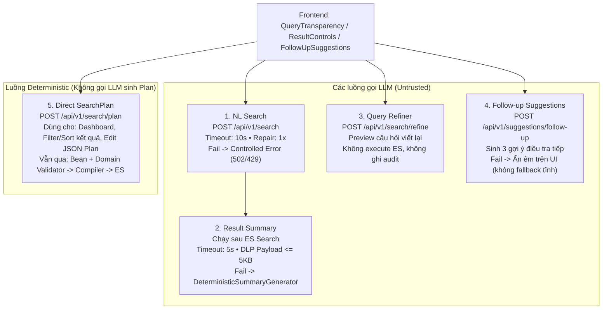

# Ngày 3: Core Flow #2 — LLM Resilience, AI Summary Guardrails, Refine, Follow-up & Editable Plan

- **Thời lượng gợi ý:** 2.5 – 3 giờ
- **Tỷ trọng:** 70% AI Engineering & Backend Java (`LlmConfig`, `LlmHttpSupport`, `ResultSummaryService`, `SummaryPayloadBuilder`, `SummaryTextValidator`, `/api/v1/search/plan`) • 30% Frontend Interactive Workflows (`QueryTransparency`, `ResultControls`, `FollowUpSuggestions`)
- **Mục tiêu cuối ngày:** Giải thích sắc bén kiến trúc đa LLM provider, chiến lược timeout/retry tách biệt, **DLP & Output Guardrails cho AI Summary**, cơ chế **Graceful Degradation** của 3 tính năng AI phụ trợ, và luồng **Human-in-the-Loop** chạy thẳng `SearchPlan` không gọi lại LLM.

---

## 1. Business Flow & So Sánh 4 Luồng AI / Deterministic

Trong hệ thống có 4 luồng xử lý chính với mức độ rủi ro và chiến lược fallback hoàn toàn khác nhau:



---

## 2. Code Walkthrough Có Dẫn Đường (`FE → BE → LLM / ES`)

### A. Tầng Frontend: Human-in-the-Loop, Immutable Plan Mutation & Lazy State (30%)
1. [query-transparency.tsx](../../frontend/src/features/search/components/query-transparency.tsx)
   - Hiển thị 3 tab minh bạch: **Query Breakdown** (bảng dễ đọc cho analyst), **Validated SearchPlan** (JSON + chế độ Edit bằng `@uiw/react-codemirror` cho `SOC_ANALYST+`), và **Compiled DSL** (chỉ đọc).
   - Dòng 92: Dùng lazy state initializer `useState(() => JSON.stringify(initialValue, null, 2))` để không `JSON.stringify` lại ở mỗi lần re-render.
   - Dòng 96–112: Parse JSON phía client để bắt lỗi cú pháp ngay lập tức, chuyển qua `onRun(parsed)` gọi `POST /api/v1/search/plan`, và map lỗi backend (ví dụ 400 validation) qua `toUiError(err)`.
   - Tích hợp nút **Correct or Refine Query** gọi `refineQuery` → cho user preview câu hỏi đã viết lại trước khi chạy lại luồng an toàn.
2. [result-controls.tsx](../../frontend/src/features/search/components/results/result-controls.tsx) & [search-plan-filters.ts](../../frontend/src/features/search/lib/search-plan-filters.ts)
   - Khi analyst thêm/bớt filter (`severity`, `event_type`, `ip`, `user`, `event_id`...) hoặc đổi sort ngay trên bảng kết quả, FE **biến đổi bất biến (immutable)** object `SearchPlanDto` hiện tại rồi gọi thẳng `POST /api/v1/search/plan` — **không gọi lại LLM**, cho phản hồi cực nhanh và 100% deterministic.
3. [follow-up-suggestions.tsx](../../frontend/src/features/search/components/follow-up-suggestions.tsx)
   - Nhận prop `suggestionKey = "${query_id}:${original_question}"` từ `useSearchWorkflow` để chỉ gọi API gợi ý đúng 1 lần cho mỗi kết quả tìm kiếm mới, tránh gọi lặp mỗi lần đổi tab hoặc re-render.

### B. Tầng Backend: LLM Infrastructure, Resilience & AI Guardrails (70%)
4. [LlmConfig.java](../../backend/src/main/java/com/soc/ai/search/config/llm/LlmConfig.java)
   - Áp dụng **Strategy Pattern + `@ConditionalOnProperty(prefix = "app.llm", name = "provider")`** để chuyển đổi linh hoạt giữa `mock` (mặc định nếu thiếu config), `gemini` và `anthropic`.
   - Clone `RestClient.Builder` tạo **2 `RestClient` độc lập với timeout khác nhau**:
     - `searchPlanClient`: `timeoutMs = 10_000ms` (bước cốt lõi, cần thêm thời gian cho structured JSON).
     - `summaryClient`: `summaryTimeoutMs = 5_000ms` (bước phụ trợ có fallback — cần fail-fast để không kéo dài thời gian phản hồi).
   - *Điểm soi sâu Java BE:* Đang dùng `SimpleClientHttpRequestFactory` (`HttpURLConnection` mặc định, không có connection pool quản lý tập trung).
5. [LlmHttpSupport.java](../../backend/src/main/java/com/soc/ai/search/llm/infrastructure/LlmHttpSupport.java) & [GeminiLlmClient.java](../../backend/src/main/java/com/soc/ai/search/llm/infrastructure/gemini/GeminiLlmClient.java)
   - `shouldRetry(exception)` (dòng 23–25): **Chỉ retry khi gặp `5xx`** (và `ResourceAccessException` lỗi mạng/timeout), **không retry `4xx` hay `429 Rate Limit`**.
   - Nếu dính HTTP 429, map thành `GeminiRateLimitException` → `NaturalLanguageSearchRateLimitException` → HTTP `429 Too Many Requests` trả về client rõ ràng.
6. [SummaryPayloadBuilder.java](../../backend/src/main/java/com/soc/ai/search/summary/application/SummaryPayloadBuilder.java)
   - **DLP (Data Loss Prevention) Guardrail trước khi gửi ra cloud LLM:**
     - Tuyệt đối không gửi trường `raw` forensic log.
     - Giới hạn cứng: `MAX_PAYLOAD_CHARACTERS = 5_000`, `MAX_SAMPLE_EVENTS = 5`, `MAX_AGGREGATION_RESULTS = 10`, `MAX_MESSAGE_LENGTH = 300`, `MAX_VALUE_LENGTH = 160`.
     - Regex `SECRET_PATTERN` tự động redact `api_key`, `password`, `token`, `secret` trước khi serialize JSON gửi cho LLM.
7. [ResultSummaryService.java](../../backend/src/main/java/com/soc/ai/search/summary/application/ResultSummaryService.java) & [SummaryTextValidator.java](../../backend/src/main/java/com/soc/ai/search/summary/domain/SummaryTextValidator.java)
   - Phát hiện ngôn ngữ từ câu hỏi gốc (`SummaryLanguageDetector` → Anh/Việt).
   - Nếu `total == 0`, bỏ qua LLM và chạy ngay `DeterministicSummaryGenerator` (tiết kiệm latency & token).
   - Nếu `total > 0` (chế độ Search): gọi thêm `ElasticsearchSummaryQueryService.load(plan)` để lấy thống kê top users/hosts/IPs/severities làm ngữ cảnh đầy đủ cho summary.
   - **Output Guardrail (`SummaryTextValidator`):** Chặn output dài `> 2.000` ký tự, chặn `` ``` ``, chặn thẻ HTML (`<...>` chống XSS), chặn Markdown heading/list, chặn JSON `{`/`[`, và bắt buộc **độ dài 3–5 câu** (đặc biệt: mask IPv4 `203.0.113.45` → `IP_ADDRESS` và số thập phân `99.5` → `DECIMAL_VALUE` trước khi đếm dấu chấm `.` kết thúc câu!).
   - Bất kỳ lỗi nào (ES summary query lỗi, LLM timeout, output không pass validator) đều rơi êm về `DeterministicSummaryGenerator` kèm `summary_source = "fallback"`.
8. [SearchController.java](../../backend/src/main/java/com/soc/ai/search/search/api/SearchController.java) (`POST /api/v1/search/plan`)
   - Phục vụ 3 kịch bản: Dashboard (`audit=false, include_summary=false`), Filter/Sort kết quả, và Edit SearchPlan (`audit=true, include_summary=true`).
   - *Tech Debt cần nắm rõ:* `SearchController` hiện dài 169 dòng, ôm orchestration (gọi executor, `instanceof` kiểm tra `Object`, gọi summary, ghi audit) thay vì đẩy xuống `SearchPlanExecutionService` ở tầng `application`.

---

## 3. Ngân Hàng Câu Hỏi Phỏng Vấn & Câu Trả Lời Mẫu (10 Câu)

### Câu 1 (Backend Java / AI Architecture): Bạn thiết kế tầng tích hợp đa LLM provider (`mock`, `gemini`, `anthropic`) như thế nào để dễ mở rộng sang model nội bộ (ví dụ Ollama / vLLM)?
- **Ý cốt lõi cần chạm:** Interface `LlmClient` (Strategy Pattern + Dependency Inversion), đăng ký bean động bằng `@ConditionalOnProperty`, cô lập SDK/HTTP detail trong package `llm.infrastructure.*`.
- **Câu trả lời mẫu (45s):**
  > "Tầng nghiệp vụ (`NaturalLanguageSearchService`, `ResultSummaryService`, `QueryRefinementService`, `FollowUpSuggestionService`) chỉ phụ thuộc vào một port duy nhất là interface `LlmClient` trong `llm.application`. Trong `LlmConfig`, em dùng `@ConditionalOnProperty(prefix = "app.llm", name = "provider")` để Spring Boot chỉ khởi tạo đúng 1 implementation (`MockLlmClient`, `GeminiLlmClient` hoặc `AnthropicLlmClient`) theo biến môi trường `LLM_PROVIDER`. Nhờ tuân thủ Open/Closed Principle, nếu cần đưa hệ thống vào môi trường SOC nội bộ cấm gọi cloud API, em chỉ cần viết thêm 1 class `OllamaLlmClient implements LlmClient` gọi endpoint OpenAI-compatible của Ollama/vLLM và thêm 1 `@Bean` mà không phải sửa bất kỳ dòng code nghiệp vụ hay guardrail nào."
- **Follow-up trap:** *"Nếu muốn hỗ trợ fallback động lúc runtime — ví dụ Gemini down thì tự chuyển sang Anthropic mà không restart app — thì cấu trúc `@ConditionalOnProperty` hiện tại cần đổi thế nào?"*
  - **Hướng đáp:** Khởi tạo cả hai bean (ví dụ `geminiClient` và `anthropicClient`) và bọc chúng bằng một **Composite / Failover `LlmClient`** (`@Primary`) kết hợp **Resilience4j Circuit Breaker**: khi circuit của Gemini mở (OPEN), composite client tự định tuyến sang Anthropic (hoặc model local) ở runtime.

---

### Câu 2 (Backend Java / Resilience): Tại sao trong `LlmConfig` bạn phải tách 2 `RestClient` với timeout khác nhau (10s vs 5s), và trong `LlmHttpSupport` chỉ retry khi gặp `5xx` mà không retry `429`?
- **Ý cốt lõi cần chạm:** Phân tầng SLA theo mức độ thiết yếu (critical path vs optional path với fallback); tránh retry storm khi gặp `429` không có exponential backoff.
- **Câu trả lời mẫu (50s):**
  > "Sinh `SearchPlan` là bước nằm trên critical path — nếu fail thì cả truy vấn thất bại, lại cần LLM xử lý schema phức tạp nên em cấp timeout `10s`. Ngược lại, `Summary` là tính năng bổ trợ đã có sẵn `DeterministicSummaryGenerator` dự phòng, nên em đặt `summaryTimeoutMs = 5s` để **fail-fast**: nếu cloud LLM chậm, hệ thống nhanh chóng cắt sang fallback thay vì bắt analyst chờ thêm 10 giây. Còn trong `LlmHttpSupport.shouldRetry()`, em chỉ retry các lỗi tạm thời phía server (`5xx` hoặc lỗi kết nối) tối đa `maxAttempts = 2`, và cố tình **không retry ngay `429 Too Many Requests`**. Vì khi đã chạm hạn mức API, việc bắn lại ngay lập tức không có jitter/backoff chỉ làm tình trạng nghẽn nặng thêm và giữ thread servlet lâu hơn; thay vào đó hệ thống map rõ sang HTTP `429` để client nắm trạng thái."
- **Follow-up trap:** *"Trong `LlmConfig`, bạn đang dùng `SimpleClientHttpRequestFactory`. Ở mức tải cao (ví dụ 200 concurrent requests), class này có điểm yếu gì?"*
  - **Hướng đáp:** `SimpleClientHttpRequestFactory` bọc `HttpURLConnection` chuẩn của JDK, không có cấu hình connection pool tinh vi (max connections per route, idle eviction, connection acquire timeout). Khi lên production tải cao, nên thay bằng **Apache HttpClient 5 (`HttpComponentsClientHttpRequestFactory`)** hoặc `JdkClientHttpRequestFactory` (Java 21 HTTP/2 + Virtual Threads) kèm bulkhead và circuit breaker.

---

### Câu 3 (AI Security / DLP): Khi sinh AI Summary, bạn làm gì để dữ liệu bảo mật nhạy cảm không bị rò rỉ ra cloud LLM?
- **Ý cốt lõi cần chạm:** Không gửi trường `raw` log; `SummaryPayloadBuilder` chỉ gửi thống kê gọn + tối đa 5 mẫu đã cắt độ dài (`MAX_MESSAGE_LENGTH = 300`, tổng payload `<= 5000` ký tự); redact secrets bằng regex `SECRET_PATTERN`.
- **Câu trả lời mẫu (45s):**
  > "Raw forensic log thường chứa stack trace, nội dung gói tin, token phiên hoặc dữ liệu nhạy cảm của hệ thống nội bộ, nên nguyên tắc của em là **raw log không bao giờ rời khỏi hạ tầng tới LLM**. Trong `SummaryPayloadBuilder`, hệ thống chỉ đóng gói một `SummaryPayload` rút gọn gồm ngữ cảnh truy vấn, tổng số sự kiện, Top-5 buckets (user/host/IP/severity) và tối đa 5 event mẫu đã bị loại bỏ trường `raw` và cắt `message` tối đa 300 ký tự, tổng JSON không vượt 5.000 ký tự. Trước khi gửi đi, mọi chuỗi còn đi qua `SECRET_PATTERN` để che tự động các mẫu `api_key`, `password`, `token`, `secret`. Nhờ vậy vừa giảm thiểu rò rỉ dữ liệu vừa tiết kiệm mạnh chi phí input token."
- **Follow-up trap:** *"Regex `SECRET_PATTERN` có đủ chặn hết PII/secrets như JWT dài, email khách hàng, hoặc số thẻ tín dụng không?"*
  - **Hướng đáp:** Regex cơ bản chỉ là lớp phòng thủ tuyến đầu cho key-value secrets. Với môi trường SOC nghiêm ngặt hơn (như ngân hàng/viễn thông), cần kết hợp thư viện DLP/PII detection chuyên dụng (như Microsoft Presidio hoặc entropy-based secret scanning) và tốt nhất là chạy **Local/Private LLM** nội bộ.

---

### Câu 4 (AI Output Guardrails): Giải thích vai trò và 1 chi tiết xử lý thông minh trong `SummaryTextValidator.java`.
- **Ý cốt lõi cần chạm:** Chặn LLM sinh HTML/XSS, Markdown, JSON rác hoặc trả lời quá dài/quá ngắn; trick mask IPv4 và số thập phân trước khi đếm số câu (3–5 câu).
- **Câu trả lời mẫu (45s):**
  > "Vì output của LLM vẫn là untrusted text sẽ hiển thị lên trình duyệt của SOC analyst, `SummaryTextValidator` đóng vai trò **Output Guardrail**. Nó kiểm tra tổng độ dài không vượt 2.000 ký tự, từ chối mọi nội dung chứa code fence `` ``` ``, thẻ HTML (phòng thủ chiều sâu chống XSS), ký hiệu đầu dòng Markdown hoặc cấu trúc JSON `{`/`[`, và ép đoạn tóm tắt phải súc tích đúng **3 đến 5 câu**. Một chi tiết thực tế khá hay là trong log bảo mật có rất nhiều địa chỉ IPv4 như `203.0.113.45` hoặc tỷ lệ phần trăm `99.5%` — nếu đếm câu ngây thơ theo dấu chấm `.` sẽ đếm sai hàng chục câu và làm summary hợp lệ bị reject nhầm. Do đó `countSentences` thay thế IPv4 thành `IP_ADDRESS` và số thập phân thành `DECIMAL_VALUE` trước khi đếm dấu kết thúc câu."
- **Follow-up trap:** *"Nếu LLM bịa ra một con số không khớp với dữ liệu Elasticsearch (hallucination số liệu) trong đoạn 4 câu văn xuôi, `SummaryTextValidator` có phát hiện được không?"*
  - **Hướng đáp:** Hiện tại `SummaryTextValidator` mới kiểm tra cấu trúc/an toàn định dạng (format safety), chưa kiểm tra tính trung thực số liệu (factual grounding). Để chống hallucination số liệu ở bản nâng cấp, có thể trích xuất tất cả các số/IP xuất hiện trong câu trả lời của LLM và đối chiếu ngược (cross-check) xem chúng có tồn tại trong `SummaryPayload` đầu vào hay không — nếu có số lạ thì fallback sang `DeterministicSummaryGenerator`!

---

### Câu 5 (AI System Design): So sánh chiến lược Graceful Degradation giữa 3 tính năng AI: SearchPlan, Summary và Follow-up Suggestions. Tại sao không dùng cùng 1 kiểu fallback?
- **Ý cốt lõi cần chạm:** Tùy mức độ thiết yếu và kỳ vọng người dùng: SearchPlan fail có kiểm soát (không tự bịa query sai), Summary có fallback deterministic (vẫn có giá trị thực từ số liệu thật), Follow-up ẩn êm (tránh gợi ý tĩnh vô nghĩa).
- **Câu trả lời mẫu (45s):**
  > "Mỗi tính năng AI có vai trò nghiệp vụ khác nhau nên không thể áp dụng cùng một kiểu fallback. Với **SearchPlan**, nếu LLM không hiểu câu hỏi sau 1 lần repair, hệ thống **bắt buộc trả lỗi có kiểm soát** kèm gợi ý chỉnh sửa thay vì tự đoán bừa một truy vấn sai làm analyst đưa ra kết luận an ninh sai lệch. Với **AI Summary**, backend đã nắm chắc toàn bộ số liệu thống kê thực từ Elasticsearch nên khi LLM lỗi hoặc timeout, `DeterministicSummaryGenerator` vẫn dựng được đoạn tóm tắt chính xác 100% theo mẫu câu Anh/Việt và gắn nhãn `summary_source = fallback`. Còn **Follow-up Suggestions** là gợi ý mang tính ngữ cảnh cao: nếu LLM không sẵn sàng, giao diện **ẩn êm khu vực gợi ý** thay vì nhồi câu mẫu tĩnh lặp đi lặp lại gây nhiễu cho analyst."
- **Follow-up trap:** *"Vì sao `QueryRefinementController` và `FollowUpSuggestionController` đều không ghi bản ghi vào bảng `search_query_logs`?"*
  - **Hướng đáp:** Cả hai endpoint này chỉ sinh văn bản gợi ý/preview, **không thực thi truy vấn nào lên dữ liệu log bảo mật trên Elasticsearch**. Chỉ khi analyst bấm xác nhận chạy câu hỏi đã tinh chỉnh hoặc bấm chọn một follow-up suggestion để gửi sang `/api/v1/search` thì mới phát sinh truy cập dữ liệu thật và được ghi audit đầy đủ.

---

### Câu 6 (Performance & Architecture): Phân tích điểm nghẽn độ trễ (Latency Waterfall) hiện tại của `NaturalLanguageSearchService.search()` và cách tối ưu.
- **Ý cốt lõi cần chạm:** Hiện đang chạy tuần tự 4 bước nặng (`LLM SearchPlan` → `ES Search` → `ES Summary Query` → `LLM Summary` → `PG Audit`); giải pháp tách Async Summary (endpoint riêng hoặc SSE) và song song hóa `ES Search` + `ES Summary Query`.
- **Câu trả lời mẫu (50s):**
  > "Nếu nhìn vào `NaturalLanguageSearchService.search()`, một truy vấn search hiện đang chạy hoàn toàn tuần tự: bước 1 gọi LLM sinh `SearchPlan` (~1–2s), bước 2 chạy `SearchPlanExecutor.search()` trên ES, bước 3 `ResultSummaryService` lại gọi thêm một truy vấn ES thứ hai (`ElasticsearchSummaryQueryService.load(plan)`) để lấy top buckets, rồi bước 4 mới gọi LLM lần hai để sinh Summary (~1–2s) và cuối cùng ghi audit PostgreSQL rồi mới trả HTTP response. Nghĩa là analyst phải chờ xong cả bước Summary mới nhìn thấy bảng event! Để tối ưu, em sẽ làm 2 việc: thứ nhất, trả kết quả event + DSL về trình duyệt ngay sau khi ES xong (giảm Time-to-First-Result xuống hơn một nửa), còn Summary sẽ tải bất đồng bộ qua endpoint riêng hoặc SSE stream; thứ hai, gộp hoặc chạy song song query lấy hits và query lấy aggregation buckets trên Elasticsearch."
- **Follow-up trap:** *"Nếu tách Summary ra chạy bất đồng bộ sau khi đã trả kết quả search, làm sao cập nhật lại cột `summary` trong bảng `search_query_logs`?"*
  - **Hướng đáp:** Khi bước search hoàn tất, ghi bản ghi audit ban đầu với `summary = null` (hoặc `status = SUCCESS`), trả `query_id` về FE; endpoint `POST /api/v1/search/{queryId}/summary` (hoặc async worker) sinh xong summary thì cập nhật bổ sung cột `summary` theo `query_id` (kèm kiểm tra quyền sở hữu `user_identity`).

---

### Câu 7 (Backend API Design & Tech Debt): Phân biệt `POST /api/v1/search` và `POST /api/v1/search/plan`. Bạn đánh giá gì về `SearchController.java` hiện tại?
- **Ý cốt lõi cần chạm:** `/api/v1/search` là NL → LLM → SearchPlan → ES; `/api/v1/search/plan` nhận thẳng `SearchPlan` (bỏ qua LLM) cho Dashboard, Edit Plan, Filter/Sort kết quả; tự nhận diện tech debt `SearchController` béo (169 dòng) & `SearchPlanExecutor.execute()` trả `Object`.
- **Câu trả lời mẫu (45s):**
  > "`POST /api/v1/search` nhận câu hỏi ngôn ngữ tự nhiên, đi qua LLM rồi mới vào pipeline validate/compile/execute. Còn `POST /api/v1/search/plan` là endpoint kỹ thuật deterministic nhận trực tiếp `SearchPlan` JSON, bỏ qua bước LLM sinh plan nhưng **vẫn đi qua nguyên bộ Bean Validation, `SearchPlanValidator`, `SearchPlanCompiler` và RBAC**, kèm các query param `audit` và `include_summary` để tái sử dụng cho 3 nhu cầu: Dashboard (`audit=false, include_summary=false`), lọc/sắp xếp lại kết quả, và chạy plan do analyst tự chỉnh tay. Tuy nhiên, khi tự review lại code, em thấy `SearchController.java` hiện hơi 'béo' (169 dòng) vì ôm luôn orchestration audit/summary và ép kiểu `instanceof` từ `Object` của `SearchPlanExecutor.execute()`. Hướng refactor gọn là tách `SearchPlanExecutionService` ở tầng `application` và đổi kiểu trả về thành `sealed interface` của Java 21."
- **Follow-up trap:** *"Nếu `POST /api/v1/search/plan` cho phép client gửi `audit=false`, liệu một attacker có tài khoản `SOC_VIEWER` có thể lợi dụng `audit=false` để truy vấn log mà không để lại dấu vết audit không?"*
  - **Hướng đáp:** **Một lỗ hổng thiết kế cực kỳ sắc bén!** Hiện tại `SearchController` đang tin vào query param `audit=false` từ phía client (để Dashboard không làm rác bảng audit mỗi 3 phút). Ở bản cứng hóa production, **không nên cho client tự tắt audit tùy ý**: nên tách riêng endpoint `GET /api/v1/dashboard/metrics` (backend tự giữ cố định 5 query tổng hợp của Dashboard, không nhận plan tùy ý) và bắt buộc `POST /api/v1/search/plan` luôn ghi audit!

---

### Câu 8 (Frontend — Human-in-the-Loop): Trong `QueryTransparency` (`query-transparency.tsx`), luồng chỉnh sửa thủ công `SearchPlan` và `Correct or Refine Query` xử lý state và lỗi như thế nào?
- **Ý cốt lõi cần chạm:** Phân tách quyền UX (`canEditPlan` chỉ mở cho `SOC_ANALYST+`), lazy init CodeMirror state, kiểm tra `JSON.parse` cục bộ trước khi gửi mạng, giữ `resetSearchPlan` (`originalAiSearchPlan`), và không cho sửa tab Compiled DSL (read-only).
- **Câu trả lời mẫu (40s):**
  > "Trong `QueryTransparency`, tab **Compiled DSL** luôn là read-only để giữ nguyên nguyên tắc trình duyệt không bao giờ gửi DSL lên server. Với tab **Validated SearchPlan**, chỉ `SOC_ANALYST` trở lên mới mở được `SearchPlanEditor` dùng CodeMirror JSON. State editor được khởi tạo lười bằng `useState(() => JSON.stringify(...))` để tránh tính toán lại mỗi lần render. Khi user bấm Run, FE chạy `JSON.parse` bắt lỗi cú pháp ngay trên trình duyệt trước khi gửi lên `/api/v1/search/plan`; nếu backend trả `400` kèm danh sách lỗi allowlist, `toUiError` gom toàn bộ chi tiết lỗi hiển thị ngay dưới editor để user sửa, hoặc bấm Reset để khôi phục về `originalAiSearchPlan`."
- **Follow-up trap:** *"Tại sao `Correct or Refine Query` không tự động chạy tìm kiếm luôn mà lại hiển thị bước preview `rewrittenQuestion` trước?"*
  - **Hướng đáp:** Theo nguyên tắc **Human-in-the-Loop** trong SOC: LLM có thể hiểu lệch ý phản hồi của analyst. Hiển thị câu hỏi đã viết lại cho phép analyst kiểm duyệt nhanh hoặc chỉnh vài từ trước khi phát sinh truy vấn ES và ghi một bản ghi audit mới.

---

### Câu 9 (Frontend — Immutable State & UX Performance): Khi analyst dùng `ResultControls` để thêm bộ lọc `severity` hoặc đổi thứ tự sắp xếp, vì sao FE không gọi lại `/api/v1/search` mà tự dựng `SearchPlan` mới?
- **Ý cốt lõi cần chạm:** Tránh gọi LLM thừa (tiết kiệm 1–3s latency + chi phí token + tránh LLM sinh lệch các filter khác); biến đổi immutable object `SearchPlanDto` qua các pure function (`search-plan-filters.ts`) dễ viết unit test.
- **Câu trả lời mẫu (40s):**
  > "Khi analyst đã có kết quả và chỉ muốn lọc thêm `severity: critical` hoặc đổi sort theo `timestamp asc`, ý định đã hoàn toàn tường minh và có cấu trúc. Nếu gọi lại `/api/v1/search` qua LLM thì vừa chậm thêm vài giây, tốn token, lại có rủi ro LLM vô tình làm thay đổi các filter khác đang có. Thay vào đó, `ResultControls` gọi các pure function trong `search-plan-filters.ts` để tạo một bản sao bất biến mới của `SearchPlanDto` (reset `page: 0`) rồi gọi thẳng `/api/v1/search/plan`. Cách viết pure function tách biệt khỏi React component cũng giúp em test logic lọc/parse multi-value rất gọn trong `search-plan-filters.test.ts`."
- **Follow-up trap:** *"Tại sao mỗi lần analyst đổi bộ lọc ở `ResultControls` thì bắt buộc phải reset `page` về `0`?"*
  - **Hướng đáp:** Nếu user đang đứng ở trang 5 (từ 100 kết quả) rồi thêm filter mới chỉ còn 8 kết quả (1 trang), việc giữ nguyên `page = 5` sẽ khiến Elasticsearch trả mảng rỗng (`from = 50`) làm người dùng hiểu lầm là không có dữ liệu.

---

### Câu 10 (Frontend — Effect Control): Trong `FollowUpSuggestions` và `useSearchWorkflow`, vì sao cần biến `followUpSuggestionKey` để điều khiển việc gọi API gợi ý?
- **Ý cốt lõi cần chạm:** Tránh gọi trùng API LLM tốn tiền khi component re-render do đổi tab, mở drawer, hoặc gõ phím; chỉ kích hoạt đúng khi có `query_id` tìm kiếm thành công mới.
- **Câu trả lời mẫu (35s):**
  > "Endpoint `/api/v1/suggestions/follow-up` gọi trực tiếp tới LLM nên phải tránh tuyệt đối việc bị bắn lặp do re-render React (ví dụ khi user chuyển tab Raw Events ↔ Analytics, bấm pin, hoặc mở chi tiết sự kiện). Trong `useSearchWorkflow`, em chỉ cập nhật `followUpSuggestionKey = "${query_id}:${original_question}"` sau khi nhận một kết quả search/aggregation hợp lệ mới. Component `FollowUpSuggestions` dùng key này làm dependency cho `useEffect` (kèm `AbortController`), nhờ đó đảm bảo mỗi phiên tìm kiếm chỉ gọi gợi ý tối đa 1 lần và hủy ngay nếu người dùng chuyển sang câu hỏi khác."
- **Follow-up trap:** *"Trong React StrictMode ở môi trường dev, `useEffect` chạy 2 lần — bạn có gặp vấn đề gọi double API LLM không?"*
  - **Hướng đáp:** Trong dev StrictMode, React mount → unmount (gọi cleanup `controller.abort()`) → mount lại lần 2; nhờ có `AbortController` trong cleanup của `useEffect`, request đầu bị hủy ngay lập tức (và ở local dev mặc định dùng `LLM_PROVIDER=mock` nên không tốn chi phí).

---

## 4. Self-Check Cuối Ngày 3 (15 Phút — Đóng Tài Liệu Lại)

- [ ] Giải thích rõ cấu trúc `@ConditionalOnProperty` + 2 `RestClient` timeout khác nhau (10s vs 5s) trong `LlmConfig`.
- [ ] Nêu được 4 cơ chế bảo vệ của `SummaryPayloadBuilder` (DLP) và `SummaryTextValidator` (Output Guardrail + mask IPv4).
- [ ] So sánh mượt mà chiến lược Graceful Degradation của 3 tính năng AI (SearchPlan / Summary / Follow-up).
- [ ] Giải thích được lỗ hổng tiềm ẩn của query param `audit=false` trên `/api/v1/search/plan` và cách khắc phục ở production.
- [ ] Trình bày được cách FE dùng `QueryTransparency` (lazy state, `originalAiSearchPlan`), `ResultControls` (immutable pure functions) và `followUpSuggestionKey` để tối ưu UX và tiết kiệm lời gọi LLM.
