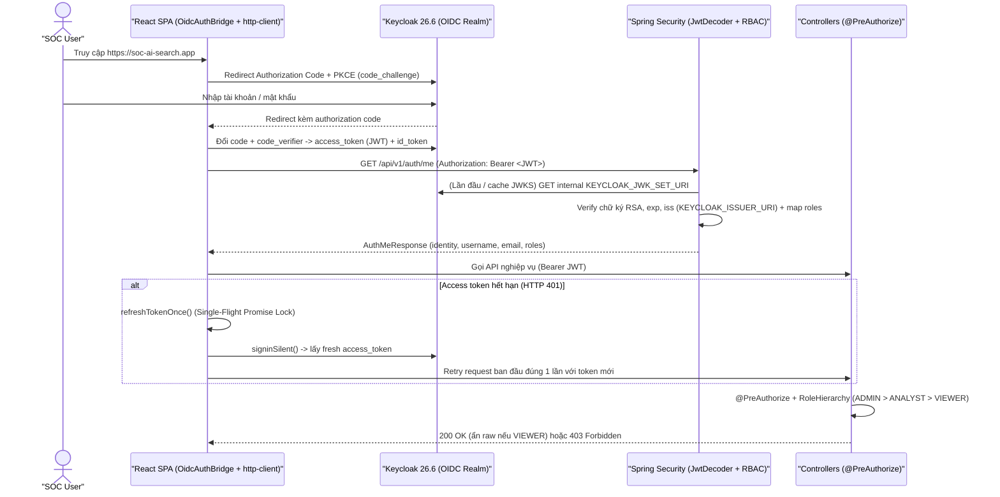

# Ngày 4: Security End-to-End — Keycloak OIDC, FE Token Lifecycle & Spring Security RBAC

- **Thời lượng gợi ý:** 2.5 – 3 giờ
- **Tỷ trọng:** 65% Backend Security / Keycloak OIDC / JWT / RBAC / Data Protection • 35% Frontend Auth Architecture (`OidcAuthBridge`, Single-Flight `401` Refresh, `App.tsx` vs `SocDashboard` Effect Order)
- **Mục tiêu cuối ngày:** Nắm chắc luồng xác thực **OIDC Authorization Code + PKCE**, hiểu sâu cách **Spring Security OAuth2 Resource Server** verify JWT và ánh xạ `RoleHierarchy`, bảo vệ trường `raw` log theo role, và giải thích vanh vách kiến trúc quản lý token + cơ chế **single-flight `refreshTokenOnce`** trên Frontend.

---

## 1. Business Flow & Sequence Xác Thực / Phân Quyền End-to-End

### Ma Trận Phân Quyền RBAC (`SOC_ADMIN > SOC_ANALYST > SOC_VIEWER`)

| Nhóm chức năng | `SOC_VIEWER` | `SOC_ANALYST` | `SOC_ADMIN` | Bảo vệ phía Backend |
| :--- | :---: | :---: | :---: | :--- |
| Search NL, `/search/plan`, Refine, Follow-up | Có | Có | Có | `@PreAuthorize("... or hasRole('SOC_VIEWER')")` |
| Xem Event Detail (metadata cơ bản) | Có | Có | Có | `EventController.detail()` (`SOC_VIEWER`) |
| Xem trường `raw` forensic log | **Không** | Có | Có | `rbacPermissionService.canViewRawLog()` → `response.withoutRaw()` |
| Chỉnh tay `SearchPlan`, Export Search CSV | **Không** | Có | Có | `CsvExportController` (`SOC_ANALYST`) + FE UX gate |
| Personal Investigations (History & Pin) | **Không** | Có | Có | `AuditQueryController` (`SOC_ANALYST`, lọc theo `currentIdentity()`) |
| System Audit Logs & Export Audit CSV | **Không** | **Không** | Có | `AuditQueryController` (`SOC_ADMIN`) |
| Ingest Event / Bulk Ingest | **Không** | **Không** | Có | `EventController.ingest*` (`SOC_ADMIN`) |

---

## 2. Code Walkthrough Có Dẫn Đường (`FE → Keycloak → BE`)

### A. Tầng Frontend: OIDC Bridge, Token Singleton & Single-Flight Refresh (35%)
1. [auth-context.tsx](../../frontend/src/features/auth/auth-context.tsx)
   - Khi `authEnabled = false` (local dev), trả về `demoAuthState` (`demo-analyst`, role `SOC_ANALYST`) giúp dev/test không cần bật Keycloak.
   - Khi `authEnabled = true`: bọc `OidcAuthProvider` (`react-oidc-context` + `oidc-client-ts`) bằng `OidcAuthBridge`.
   - Dòng 154–200: Ngay khi có `accessToken`, FE gọi `/api/v1/auth/me` (kèm `AbortController`) để lấy **identity & roles chính thống từ backend**. Đặc biệt chú ý dòng 188–200: biến `backendStateMatchesToken = backendUserState.accessToken === accessToken` ngăn việc dùng nhầm quyền của token cũ trong lúc token mới đang load (`backendUserLoading = true`).
   - Dòng 221–233: `refreshAccessToken` gọi `oidc.signinSilent()`; `signOut` truyền `id_token_hint` và `post_logout_redirect_uri` để đăng xuất sạch phiên SSO trên Keycloak.
2. [App.tsx](../../frontend/src/app/App.tsx) (dòng 52–58) & [auth-token.ts](../../frontend/src/shared/services/api/auth-token.ts)
   - `App.tsx` dùng `useEffect` đăng ký callback `setAuthTokenHandlers({ getAccessToken, refreshAccessToken })` vào module `auth-token.ts`, nhờ đó tầng service thuần TypeScript (`http-client.ts`) đọc được token mà không phụ thuộc React hook.
   - **Single-Flight Lock (`auth-token.ts` dòng 36–48):** Biến module-level `tokenRefreshPromise` đảm bảo nếu **5 request Dashboard cùng gặp `401` đồng thời**, chỉ có **đúng 1 lần gọi `signinSilent()`** tới Keycloak; 4 request còn lại cùng `await` chung Promise đó, rồi `.finally(() => { tokenRefreshPromise = null })` giải phóng khóa.
3. [http-client.ts](../../frontend/src/shared/services/api/http-client.ts) (dòng 40–47)
   - Nếu `response.status === 401` và chưa bị abort → gọi `refreshTokenOnce()` → nếu lấy được `freshToken` thì retry request gốc đúng 1 lần với `tokenOverride`.
4. [permissions.ts](../../frontend/src/features/auth/permissions.ts)
   - `hasAtLeastRole`: **Fail-closed khi `loading === true`** (trả về `false` để không lộ nhầm nút Admin/Export khi quyền chưa load xong).

### B. Tầng Backend: Spring Security OAuth2 Resource Server & RBAC (65%)
5. [SecurityConfig.java](../../backend/src/main/java/com/soc/ai/search/security/SecurityConfig.java)
   - `@EnableMethodSecurity`: Kích hoạt `@PreAuthorize` trên từng method controller.
   - `csrf.disable()` + `SessionCreationPolicy.STATELESS`: Không dùng HTTP session hay cookie xác thực.
   - `PUBLIC_ENDPOINTS`: Chỉ mở `/api/v1/health/live`, `/api/v1/health/ready`, `/swagger-ui/**`, `/v3/api-docs/**`, cộng `HttpMethod.OPTIONS` cho CORS preflight; còn lại `anyRequest().authenticated()`.
   - **Tách `issuer-uri` và `jwk-set-uri` (dòng 110–121):** `NimbusJwtDecoder.withJwkSetUri(jwt.getJwkSetUri())` tải public key nội bộ từ container `keycloak:8080`, nhưng vẫn gắn `JwtValidators.createDefaultWithIssuer(jwt.getIssuerUri())` để xác thực claim `iss` khớp domain public (`https://auth.soc-ai-search.app` hoặc `http://localhost:8082/...`).
   - `RoleHierarchy` (dòng 98–102): `ROLE_SOC_ADMIN > ROLE_SOC_ANALYST > ROLE_SOC_VIEWER`.
   - `StrictHttpFirewall` (dòng 134–138): Mở `setAllowUrlEncodedPercent(true)` để cho phép lookup `event_id` có ký tự đặc biệt đã URL-encode.
   - `CorsConfigurationSource` (dòng 146–166): Khai báo tường minh `exposedHeaders` gồm `Content-Disposition` và `X-Export-Truncated` để JavaScript trình duyệt đọc được tên file và cờ cắt dòng khi export CSV cross-origin (`soc-ai-search.app` → `api.soc-ai-search.app`).
   - Custom `JsonAuthenticationEntryPoint` (401) và `JsonAccessDeniedHandler` (403) trả JSON thống nhất thay vì HTML trang lỗi mặc định.
6. [KeycloakJwtGrantedAuthoritiesConverter.java](../../backend/src/main/java/com/soc/ai/search/security/KeycloakJwtGrantedAuthoritiesConverter.java)
   - Đọc cả `realm_access.roles` và `resource_access.<client>.roles` trong JWT, chuẩn hóa thêm tiền tố `ROLE_` (ví dụ `SOC_ANALYST` → `ROLE_SOC_ANALYST`) để khớp với `hasRole('SOC_ANALYST')` của Spring Security.
7. [RbacPermissionService.java](../../backend/src/main/java/com/soc/ai/search/security/RbacPermissionService.java) & [EventController.java](../../backend/src/main/java/com/soc/ai/search/event/api/EventController.java) (dòng 72–75)
   - `RbacPermissionService` dùng `roleHierarchy.getReachableGrantedAuthorities(...)` để đánh giá quyền nhất quán theo phân cấp.
   - Trong `EventController.detail()`: dù `SOC_VIEWER` được phép gọi endpoint, backend vẫn kiểm tra `rbacPermissionService.canViewRawLog()` — nếu `false`, trả `response.withoutRaw()` (`raw = null`, `raw_visible = false`).

---

## 3. Ngân Hàng Câu Hỏi Phỏng Vấn & Câu Trả Lời Mẫu (11 Câu)

### Câu 1 (Security / OIDC): Trình bày luồng đăng nhập Keycloak OIDC trong dự án. Tại sao SPA phải dùng Authorization Code + PKCE thay vì Implicit Flow hay lưu client secret ở FE?
- **Ý cốt lõi cần chạm:** SPA là **public client** (mọi code chạy trên trình duyệt đều bị đọc được nên không thể giữ `client_secret`); PKCE (`code_verifier` + `code_challenge`) chống đánh cắp authorization code; Backend verify JWT bất đối xứng bằng JWKS mà không cần gọi Keycloak trên mỗi request.
- **Câu trả lời mẫu (50s):**
  > "React SPA là một *public client* nên không bao giờ được nhúng `client_secret` vào bundle JavaScript. Vì vậy hệ thống dùng **OIDC Authorization Code Flow với PKCE** qua `oidc-client-ts`: trình duyệt tạo một chuỗi bí mật ngẫu nhiên `code_verifier`, băm SHA-256 thành `code_challenge` gửi sang Keycloak. Sau khi user đăng nhập, Keycloak trả về `authorization code`, SPA phải nộp lại `code_verifier` gốc để đổi lấy JWT `access_token` và `id_token` — ngăn attacker đánh cắp code giữa đường. Khi FE gửi `Authorization: Bearer <JWT>` tới Spring Boot, backend xác thực chữ ký RSA bằng public key đã cache từ JWKS endpoint, kiểm tra `iss` và `exp` hoàn toàn stateless mà không cần gọi sang Keycloak trên từng API request."
- **Follow-up trap:** *"Nếu tài khoản một analyst vừa bị khóa hoặc thu hồi quyền `SOC_ADMIN` trên Keycloak, tại sao JWT cũ vẫn có thể gọi được API thêm vài phút?"*
  - **Hướng đáp:** Đó là trade-off kinh điển của stateless JWT: backend chỉ kiểm tra chữ ký và `exp` nội bộ nên token cũ còn hiệu lực cho tới khi hết hạn. Cách giảm thiểu chuẩn production là đặt **access token TTL ngắn (5–15 phút)** kết hợp silent refresh, hoặc với tác vụ siêu nhạy cảm thì kiểm tra thêm revocation list (Redis blacklist) / OAuth2 Token Introspection.

---

### Câu 2 (Spring Security): Tại sao bạn cấu hình `csrf(csrf -> csrf.disable())` trong `SecurityConfig.java`? Như vậy có mất an toàn không?
- **Ý cốt lõi cần chạm:** CSRF chỉ xảy ra khi trình duyệt **tự động đính kèm credential** (cookie session) vào cross-site request; API của dự án hoàn toàn `STATELESS` và đọc token từ header `Authorization: Bearer`.
- **Câu trả lời mẫu (35s):**
  > "Tấn công CSRF lợi dụng việc trình duyệt tự động gửi kèm cookie xác thực khi trang độc hại thực hiện request sang domain của mình. Trong SOC AI Search, `SecurityConfig` đặt `SessionCreationPolicy.STATELESS`, backend không tạo session cookie và chỉ chấp nhận xác thực qua header tường minh `Authorization: Bearer <JWT>` do JavaScript chủ động gắn vào. Vì trang web bên thứ ba không thể đọc được token hay ép trình duyệt tự gắn header `Authorization` qua form submit, việc tắt CSRF là chuẩn mực và an toàn cho REST API thuần Bearer JWT."
- **Follow-up trap:** *"Vậy nếu không lo CSRF thì lưu access token trên trình duyệt lại đối mặt với nguy cơ nào lớn hơn?"*
  - **Hướng đáp:** Nguy cơ **XSS (Cross-Site Scripting)** — nếu attacker chạy được JS độc hại trên trang, họ có thể đánh cắp access token trong bộ nhớ/storage. Vì vậy cần phòng thủ XSS nghiêm ngặt: React escape mặc định, `SummaryTextValidator` chặn HTML từ LLM, không dùng `dangerouslySetInnerHTML`, và trên production nên bổ sung header **Content-Security-Policy (CSP)** ở Caddy/Nginx (hoặc mô hình BFF — Backend For Frontend với HttpOnly SameSite cookie).

---

### Câu 3 (Docker & Keycloak Networking): Vì sao trong `docker-compose.yml` và `SecurityConfig.java` bạn phải tách 2 biến `KEYCLOAK_ISSUER_URI` và `KEYCLOAK_JWK_SET_URI`?
- **Ý cốt lõi cần chạm:** Khác biệt DNS giữa trình duyệt bên ngoài (`localhost:8082` / `https://auth.soc-ai-search.app`) và mạng nội bộ Docker (`http://keycloak:8080`); claim `iss` trong JWT luôn mang URL public mà browser đã dùng.
- **Câu trả lời mẫu (45s):**
  > "Đây là một bài toán thực tế rất hay gặp khi chạy OIDC trong Docker. Trình duyệt truy cập Keycloak qua URL bên ngoài (ví dụ `http://localhost:8082/realms/soc-ai-search` ở local hoặc `https://auth.soc-ai-search.app/...` ở production), nên claim `iss` bên trong JWT luôn mang URL này. Nhưng container `backend` nằm bên trong mạng Docker không gọi ngược được `localhost:8082` (và trên VPS cũng không nên đi vòng ra ngoài internet/hairpin NAT chỉ để tải JWKS). Vì vậy trong `SecurityConfig.jwtDecoder()`, em cấu hình `NimbusJwtDecoder.withJwkSetUri(...)` tải public key qua DNS nội bộ `http://keycloak:8080/.../certs`, đồng thời vẫn gắn `JwtValidators.createDefaultWithIssuer(issuerUri)` để kiểm tra nghiêm ngặt claim `iss` khớp với URL public."
- **Follow-up trap:** *"Nếu chỉ cấu hình `withJwkSetUri` mà quên dòng `setJwtValidator(JwtValidators.createDefaultWithIssuer(...))` thì có rủi ro gì?"*
  - **Hướng đáp:** `NimbusJwtDecoder.withJwkSetUri(...)` mặc định **chỉ kiểm tra chữ ký và `exp`/`nbf`, không kiểm tra `iss`**. Nếu quên gắn validator issuer, một token hợp lệ ký bởi realm khác trên cùng cụm Keycloak hoặc issuer khác cấu hình sai có thể lọt qua bước kiểm tra.

---

### Câu 4 (Spring Security RBAC): `RoleHierarchy` hoạt động như thế nào trong Spring Security, và tại sao phải kiểm tra quyền ở cả FE lẫn BE?
- **Ý cốt lõi cần chạm:** Khai báo `SOC_ADMIN > SOC_ANALYST > SOC_VIEWER` giúp endpoint chỉ cần ghi role tối thiểu (`hasRole('SOC_ANALYST')`) mà Admin tự động kế thừa; FE chỉ để ẩn/hiện UX, BE mới là lớp bảo vệ thực sự chống bypass bằng curl/Postman.
- **Câu trả lời mẫu (45s):**
  > "Trong `SecurityConfig`, bean `RoleHierarchy` định nghĩa phân cấp `ROLE_SOC_ADMIN > ROLE_SOC_ANALYST > ROLE_SOC_VIEWER`. Nhờ vậy, khi controller gắn `@PreAuthorize("@rbacPermissionService.authDisabled() or hasRole('SOC_ANALYST')")`, Spring Security tự mở rộng tập quyền đạt tới (`reachable authorities`) để `SOC_ADMIN` tự động đi qua mà không phải lặp lại danh sách role ở mọi nơi. Về mặt tách lớp, kiểm tra quyền trong `permissions.ts` ở Frontend chỉ phục vụ trải nghiệm người dùng (ẩn tab Audit Logs hay nút Export khỏi Viewer), hoàn toàn không phải lớp bảo mật vì bất kỳ ai cũng có thể gọi thẳng API qua `curl` hoặc DevTools. Mọi thực thi bảo mật bắt buộc nằm ở `@PreAuthorize` và `RbacPermissionService` phía backend."
- **Follow-up trap:** *"Tại sao trong `SecurityConfig` bạn phải cấu hình `exposedHeaders` cho `Content-Disposition` và `X-Export-Truncated`?"*
  - **Hướng đáp:** Theo chuẩn CORS của trình duyệt, khi FE (`soc-ai-search.app`) gọi API khác origin (`api.soc-ai-search.app`), JavaScript chỉ được đọc 7 *CORS-safelisted response headers* cơ bản (`Content-Type`, `Cache-Control`...). Nếu backend không gửi `Access-Control-Expose-Headers: Content-Disposition, X-Export-Truncated`, `response.headers.get('X-Export-Truncated')` ở FE sẽ luôn trả về `null` khiến UI không cảnh báo được cho user khi file CSV bị cắt ở 10.000 dòng!

---

### Câu 5 (Field-Level Data Security): Cách bạn ngăn `SOC_VIEWER` đọc trường `raw` forensic log khi họ vẫn có quyền xem chi tiết sự kiện là gì?
- **Ý cốt lõi cần chạm:** Enforcement ngay tại `EventController.detail()` bằng `rbacPermissionService.canViewRawLog()` → `response.withoutRaw()` trả `raw: null, raw_visible: false`; không tin việc FE chỉ ẩn thẻ HTML.
- **Câu trả lời mẫu (40s):**
  > "Một sai lầm phổ biến là backend vẫn trả trường `raw` trong JSON response rồi để Frontend kiểm tra role để ẩn đi — nếu làm vậy, `SOC_VIEWER` chỉ cần mở tab Network của DevTools là đọc trọn vẹn raw log. Trong `EventController.detail()`, endpoint mở ở mức `SOC_VIEWER` để xem metadata cơ bản (`timestamp`, `severity`, `ip`, `message`), nhưng trước khi trả response, backend gọi `rbacPermissionService.canViewRawLog()`. Nếu user chưa đạt tối thiểu `SOC_ANALYST`, backend gọi `response.withoutRaw()` để gán `raw = null` và `raw_visible = false` ngay từ server — đảm bảo dữ liệu nhạy cảm không bao giờ đi qua mạng tới Viewer."
- **Follow-up trap:** *"Có cần tối ưu thêm ở tầng truy vấn Elasticsearch để thậm chí không tải trường `raw` từ ES về JVM khi người gọi là `SOC_VIEWER` không?"*
  - **Hướng đáp:** Rất nên! Hiện tại `EventDetailService.findById()` gọi `GetRequest` lấy toàn bộ `_source` rồi `EventController` mới lược `raw`. Nếu truyền cờ `includeRaw` xuống `EventDetailService` và dùng `_sourceExcludes("raw")` ngay trên `GetRequest` của Elasticsearch khi user là Viewer, ta vừa tăng defense-in-depth vừa giảm băng thông và bộ nhớ JVM khi raw log rất lớn.

---

### Câu 6 (Spring Security Firewall): Vì sao trong `SecurityConfig` bạn tùy biến `StrictHttpFirewall` với `setAllowUrlEncodedPercent(true)`? Có rủi ro gì không?
- **Ý cốt lõi cần chạm:** Mặc định Spring Security chặn `%25` để chống double-encoding path traversal; mở ra vì `event_id` trên path `/api/v1/events/{event_id}` có thể chứa ký tự đặc biệt đã encode, kèm biện pháp kiểm soát (`normalizeEventId` chỉ tra cứu document ID trên ES, không ghép đường dẫn file hệ thống).
- **Câu trả lời mẫu (40s):**
  > "Mặc định `StrictHttpFirewall` từ chối URL chứa `%25` (URL-encoded percent) để ngăn tấn công double-encoding nhằm lách luật phân quyền theo path hoặc path traversal. Trong hệ thống của em, `event_id` lấy từ ES document ID có thể chứa ký tự đặc biệt khi encode trên path `/api/v1/events/{event_id}`, nên cần bật `setAllowUrlEncodedPercent(true)`. Tuy nhiên em không mở rộng tùy tiện các cờ nguy hiểm khác như `setAllowUrlEncodedSlash` hay `setAllowSemicolon`, và trong `EventController.normalizeEventId()` ID sau khi decode chỉ được truyền vào `GetRequest.id(...)` có tham số hóa của `ElasticsearchClient` — không nối chuỗi URL hay đọc file hệ thống, đồng thời phân quyền bảo vệ bằng `@PreAuthorize` trên method thay vì chỉ dựa vào path matcher."
- **Follow-up trap:** *"Nếu muốn bỏ hẳn việc nới lỏng `StrictHttpFirewall` thì thiết kế API thay thế nên làm thế nào?"*
  - **Hướng đáp:** Giới hạn định dạng `event_id` hoàn toàn là UUID sạch (như `SearchPlanContract` đang quy định cho filter `event_id`) hoặc truyền `event_id` qua query parameter (`GET /api/v1/events/detail?event_id=...`) thay vì path variable.

---

### Câu 7 (Infrastructure Security): Trong `docker-compose.yml`, Elasticsearch đang đặt `xpack.security.enabled: "false"`. Nếu interviewer chê điểm này không an toàn thì bạn trả lời sao?
- **Ý cốt lõi cần chạm:** Thừa nhận thẳng đây là đánh đổi cho phạm vi MVP (chỉ bind `127.0.0.1:9200` + không expose qua Caddy + firewall VPS chỉ mở 22/80/443); nêu rõ giải pháp **Defense-in-Depth** cho production (bật TLS nội bộ, ES authentication/API key, `ELASTICSEARCH_USERNAME/PASSWORD` đã có sẵn trong `ElasticsearchConfig`).
- **Câu trả lời mẫu (45s):**
  > "Ở bản MVP hiện tại, Elasticsearch không mở ra internet công cộng — port 9200 chỉ bind vào `127.0.0.1` trên VPS, không định tuyến qua Caddy và chỉ các container cùng Docker network mới gọi tới được. Tuy nhiên, theo nguyên tắc **Zero Trust / Defense-in-Depth**, chỉ dựa vào network isolation là chưa đủ cho production vì nếu một container khác trong cùng mạng bị chiếm quyền sẽ truy cập thẳng vào toàn bộ log ES. Vì vậy trong `ElasticsearchConfig.java`, em đã viết sẵn hỗ trợ Basic Auth (`ELASTICSEARCH_USERNAME` / `ELASTICSEARCH_PASSWORD`), và bước lên production chuẩn sẽ là bật `xpack.security.enabled: true`, cấp chứng chỉ TLS nội bộ cho HTTP/transport layer và dùng service account / API Key giới hạn đúng quyền đọc/ghi trên index `soc-events-*`."
- **Follow-up trap:** *"Trong `ElasticsearchConfig`, bạn đang truyền Basic Auth bằng header tự mã hóa Base64. Nếu không bật TLS (HTTPS) giữa Backend và ES thì sao?"*
  - **Hướng đáp:** Basic Auth đi trên HTTP thuần có thể bị nghe lén trong nội bộ mạng container/VLAN. Do đó Basic Auth hoặc API Key bắt buộc phải đi kèm **TLS (`https://elasticsearch:9200`)** cấu hình truststore cho `RestClient`.

---

### Câu 8 (Frontend Concurrency — Điểm sáng cực mạnh): Giải thích cơ chế **Single-Flight `refreshTokenOnce()`** trong `auth-token.ts` và tại sao nó đặc biệt quan trọng với trang Dashboard.
- **Ý cốt lõi cần chạm:** Trang Dashboard bắn **5 API song song** (`Promise.allSettled`); nếu access token vừa hết hạn, cả 5 request cùng trả `401`; dùng biến module `tokenRefreshPromise` để gộp 5 lời gọi refresh thành **đúng 1 lần `signinSilent()`** tới Keycloak.
- **Câu trả lời mẫu (50s):**
  > "Trang Dashboard gọi đồng thời 5 truy vấn `/api/v1/search/plan` qua `Promise.allSettled`. Khi access token vừa hết hạn, cả 5 request có thể cùng lúc nhận về HTTP `401` trong vòng vài mili-giây. Nếu mỗi request tự gọi `oidc.signinSilent()` riêng lẻ, ta sẽ tạo ra **refresh stampede**: 5 iframe/request bắn dồn dập vào Keycloak, có thể gây lỗi rotation refresh token hoặc làm fail chéo lẫn nhau. Trong `auth-token.ts`, em cài mẫu **Single-Flight Promise Lock**: request `401` đầu tiên tạo `tokenRefreshPromise = refreshAccessTokenProvider()`, 4 request đến sau thấy `tokenRefreshPromise` khác `null` sẽ `await` chung đúng promise đó. Khi hoàn tất, khối `.finally()` reset `tokenRefreshPromise = null`, rồi cả 5 request trong `http-client.ts` đều nhận được token mới và retry sạch sẽ đúng 1 lần."
- **Follow-up trap:** *"Nếu request đã retry với `freshToken` mà server vẫn trả `401` (ví dụ phiên SSO trên Keycloak đã hết hạn hoàn toàn), code có bị vòng lặp vô hạn không?"*
  - **Hướng đáp:** Không! Trong `http-client.ts`, logic kiểm tra `if (response.status === 401)` là lệnh `if` tuyến tính chạy đúng 1 lần, không dùng đệ quy nên tuyệt đối không bị infinite retry loop; nếu lần 2 vẫn `401`, `requestJson` ném `ApiError(401)` ra UI yêu cầu người dùng đăng nhập lại.

---

### Câu 9 (Frontend React Lifecycle — Câu hỏi sâu về React!): Giải thích vấn đề thứ tự chạy `useEffect` cha-con giữa `App.tsx` (`setAuthTokenHandlers`) và `SocDashboard.tsx`, và vì sao cần prop `accessTokenReady`?
- **Ý cốt lõi cần chạm:** Trong React, **`useEffect` của component con (`SocDashboard`) chạy TRƯỚC `useEffect` của component cha (`App`)**; nếu `SocDashboard` gọi API ngay khi mount mà chưa chờ `accessTokenReady` và auth hoàn tất, request bắn đi trước khi `setAuthTokenHandlers` kịp gắn token → `401 Unauthorized`.
- **Câu trả lời mẫu (50s):**
  > "Đây là một bug thật em từng gặp khi hard refresh trực tiếp tại `/dashboard` trên production. Trong vòng đời React, sau khi commit DOM, **`useEffect` của component con luôn chạy trước `useEffect` của component cha**. `App.tsx` đăng ký `setAuthTokenHandlers(() => auth.accessToken)` trong `useEffect`, còn `SocDashboard` lại gọi 5 API Dashboard trong `useEffect` của chính nó. Khi hard refresh, lúc `SocDashboard` chạy effect thì OIDC chưa hydrate xong hoặc `App` chưa kịp cập nhật token handler, khiến request bắn đi không có header `Authorization` và dính 401. Em xử lý triệt để bằng 2 lớp: (1) truyền `authLoading`, `authenticated`, `accessTokenReady` để khóa cổng `canFetchDashboard` trên `SocDashboard`, và (2) bổ sung `401` refresh-and-retry tập trung trong `http-client.ts`."
- **Follow-up trap:** *"Tại sao lúc đó bạn không sửa bằng cách mở public endpoint `/api/v1/search/plan` để đỡ bị 401?"*
  - **Hướng đáp:** Tuyệt đối không! `/api/v1/search/plan` truy vấn trực tiếp toàn bộ dữ liệu log bảo mật SOC trong Elasticsearch; mở public endpoint sẽ tạo lỗ hổng lộ dữ liệu nghiêm trọng. Lỗi nằm ở auth synchronization trên Frontend nên bắt buộc sửa đúng nguyên nhân gốc trên Frontend.

---

### Câu 10 (Frontend State Consistency): Trong `auth-context.tsx`, tại sao `OidcAuthBridge` lại lưu cặp `{ accessToken, user }` trong `backendUserState` rồi so sánh `backendUserState.accessToken === accessToken`?
- **Ý cốt lõi cần chạm:** Tránh **stale state** khi đổi user hoặc đổi token (silent renew); tính toán *derived state* (`backendUserLoading`) đồng bộ trong `useMemo` thay vì phải gọi `setState(loading: true)` thừa trong `useEffect`.
- **Câu trả lời mẫu (40s):**
  > "Khi `accessToken` thay đổi (sau đăng nhập hoặc silent refresh), `useEffect` sẽ gọi `/api/v1/auth/me` bất đồng bộ. Nếu chỉ lưu riêng `user` mà không gắn kèm `accessToken` tương ứng, trong nhịp render chuyển giao giữa token mới và lúc `/auth/me` trả về, UI có thể tạm thời hiển thị quyền của token cũ hoặc phải gọi `setLoading(true)` đồng bộ trong effect gây thêm 1 vòng re-render thừa. Bằng cách lưu `backendUserState = { accessToken, user, errorMessage }` và kiểm tra `backendStateMatchesToken = backendUserState.accessToken === accessToken`, em suy ra trực tiếp `backendUserLoading` ngay trong `useMemo` — vừa tránh stale role, vừa giữ render sạch chuẩn React 19."
- **Follow-up trap:** *"Nếu backend `/api/v1/auth/me` trả lỗi mạng tạm thời, user có bị đá ra màn hình trắng không?"*
  - **Hướng đáp:** Không hẳn trắng trang: `OidcAuthBridge` có fallback đọc tạm claims từ `user.profile` (`rolesFromProfile`) để dựng `identity`/`tokenRoles`, đồng thời gắn `backendUserError` vào `errorMessage` để thông báo cho người dùng biết trạng thái đồng bộ quyền gặp sự cố.

---

### Câu 11 (Frontend Auth Security): Nếu interviewer hỏi *"Trong `auth-context.tsx` bạn đã có `rolesFromProfile(user.profile)` trên FE rồi, sao vẫn cần gọi thêm `GET /api/v1/auth/me` lên Backend?"*
- **Ý cốt lõi cần chạm:** Single Source of Truth từ Backend; tránh trường hợp ID token trên FE thiếu `realm_access` hoặc mapping khác với `KeycloakJwtGrantedAuthoritiesConverter` phía Spring Security.
- **Câu trả lời mẫu (35s):**
  > "Trong Keycloak, mặc định `id_token` và `access_token` có thể có cấu hình mapper claims khác nhau, và Backend còn có logic chuẩn hóa thêm như `RoleHierarchy`, `KeycloakJwtGrantedAuthoritiesConverter` hay fallback identity (`preferred_username` → `email` → `sub`). Gọi `GET /api/v1/auth/me` giúp Frontend lấy chính xác danh tính và tập quyền mà Spring Security thực sự nhìn thấy sau khi verify JWT — tránh tình huống lệch pha kiểu UI tưởng user có quyền nhưng gọi API lại bị 403."
- **Follow-up trap:** *"Nhân tiện, trong `frontend/src/features/auth/services/auth-api.ts` cũng có hàm `getCurrentUser` gọi `/api/v1/auth/me` nhưng `auth-context.tsx` lại tự viết `fetch` riêng — bạn giải thích sao?"*
  - **Hướng đáp:** Đó đúng là một điểm tech debt nhỏ em đã phát hiện khi tự audit codebase (`auth-api.ts` đang là dead code). Lý do ban đầu `auth-context.tsx` dùng `fetch` riêng là vì nó truyền trực tiếp `accessToken` vừa nhận từ `oidc.user` trước khi `App.tsx` chạy `useEffect` gắn `setAuthTokenHandlers`. Hướng chuẩn hóa là hợp nhất thành một hàm dùng chung nhận tham số `tokenOverride` trong `auth-api.ts` và xóa phần trùng lặp.

---

## 4. Self-Check Cuối Ngày 4 (15 Phút — Đóng Tài Liệu Lại)

- [ ] Vẽ lại luồng **OIDC Authorization Code + PKCE** và giải thích vì sao SPA không dùng `client_secret`.
- [ ] Giải thích trôi chảy 4 điểm trong `SecurityConfig.java`: `csrf.disable()`, tách `issuer-uri` vs `jwk-set-uri`, `RoleHierarchy`, và CORS `exposedHeaders`.
- [ ] Nêu chính xác cách backend ngăn `SOC_VIEWER` đọc `raw` log (`EventController.detail()` + `withoutRaw()`).
- [ ] Vẽ/mô tả cơ chế **Single-Flight `refreshTokenOnce()`** khi 5 API Dashboard cùng gặp `401`.
- [ ] Giải thích rõ quy luật **child `useEffect` chạy trước parent `useEffect`** trong React giữa `SocDashboard` và `App.tsx`.
