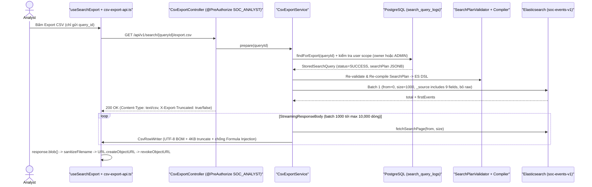

# Ngày 5: Dashboard, Audit/Transactions, Safe Replay CSV Export & Events (`FE → BE → PG + ES`)

- **Thời lượng gợi ý:** 2.5 – 3 giờ
- **Tỷ trọng:** 70% Backend Java / JPA Transactions / Security Audit / Streaming CSV Export / Elasticsearch Pagination & Bulk Ingest • 30% Frontend (`SocDashboard`, `Promise.allSettled`, `useSearchExport`, Blob Download)
- **Mục tiêu cuối ngày:** Hiểu sâu cơ chế **Transaction Propagation (`REQUIRES_NEW`)**, **Fail-Closed Audit**, **`AuditErrorSanitizer`**, kiến trúc **Safe Replay CSV Export** (streaming + chống Formula Injection + **bẫy `from + size` deep pagination**), HTTP `207 Multi-Status` của bulk ingest, và kỹ thuật **Dashboard resilience** trên React.

---

## 1. Business Flow & Sequence End-to-End

### A. Luồng Safe Replay CSV Export (`FE → BE → PG → ES → Stream CSV`)

### B. Luồng Dashboard 5 Widgets Song Song
`SocDashboard.tsx` (sau khi `canFetchDashboard === true`) bắn **5 lời gọi `POST /api/v1/search/plan?audit=false` song song** qua `Promise.allSettled`:
1. `failedLogins` (24h, `event_type: ["failed_login"]`, `size: 1` chỉ cần `total`)
2. `criticalHigh` (24h, `severity: ["critical", "high"]`, `size: 1`)
3. `eventsOverTime` (`date_histogram`, `interval: hour`, đồng thời lấy `total` làm KPI tổng sự kiện)
4. `severityDistribution` (`group_by`, `field: severity`)
5. `topSourceIps` (`top_n`, `field: ip`, `top_n: 5`)

---

## 2. Code Walkthrough Có Dẫn Đường (`FE → BE → PG + ES`)

### A. Tầng Frontend: Dashboard Resilience & Safe Blob Download (30%)
1. [soc-dashboard.tsx](../../frontend/src/features/dashboard/components/soc-dashboard.tsx) & [dashboard-searchplans.ts](../../frontend/src/features/dashboard/lib/dashboard-searchplans.ts)
   - Dòng 36–37: `canFetchDashboard = !authEnabled || (!authLoading && authenticated && accessTokenReady)` chặn auth race condition khi hard refresh.
   - Dòng 56–63: Dùng `Promise.allSettled` thay vì `Promise.all` để nếu 1 widget lỗi mạng/ES, 4 widget còn lại vẫn render dữ liệu bình thường; nhưng nếu bất kỳ request nào trả `401` (dòng 68–80), xóa dữ liệu cũ và hiển thị lỗi phiên đăng nhập rõ ràng.
   - Dòng 34–35 & 44–46: `refreshingRef` + `intervalAbortRef` ngăn timer auto-refresh 3 phút chồng chéo khi lần tải trước chưa xong và dọn sạch request khi rời trang.
2. [use-search-export.ts](../../frontend/src/features/search/hooks/use-search-export.ts) & [csv-export-api.ts](../../frontend/src/features/search/services/csv-export-api.ts)
   - `useSearchExport` quản lý `ExportStatus` (`idle/loading/success/error`), `AbortController` hủy download cũ khi chuyển search mới (`reset()`).
   - `csv-export-api.ts`: `sanitizeFilename` loại bỏ ký tự điều khiển ASCII (`<= 31`, `127`) và ký tự phá đường dẫn (`/\?%*:|"<>`), ép đuôi `.csv`; `downloadCsvBlob` tạo object URL ẩn, click tải xuống, rồi gọi `URL.revokeObjectURL(url)` tránh rò rỉ bộ nhớ trình duyệt.
   - *Tech Debt thực tế cần nhớ:* Cả `exportSearchCsv` (`csv-export-api.ts:42`) và `exportAuditLogs` (`history-api.ts:171`) đang gọi thẳng `fetch(...)` thay vì đi qua `http-client.ts` nên **chưa có 401 refresh-and-retry** như các API JSON.

### B. Tầng Backend: Audit Transactions, Secret Redaction, Streaming Export & Events (70%)
3. [AuditPersistenceService.java](../../backend/src/main/java/com/soc/ai/search/audit/application/AuditPersistenceService.java) & [AuditErrorSanitizer.java](../../backend/src/main/java/com/soc/ai/search/audit/application/AuditErrorSanitizer.java)
   - `@Transactional(propagation = Propagation.REQUIRES_NEW)` + `repository.saveAndFlush(queryLog)`: mở một transaction tách biệt hoàn toàn để bản ghi `FAILED` audit vẫn commit xuống PostgreSQL ngay cả khi nghiệp vụ bên ngoài ném exception/rollback, và ép flush ngay để bắt `DataAccessException` lập tức.
   - `AuditErrorSanitizer.sanitize(exception)`: Redact regex `(api_key|password|token|secret|key)=...` và `Bearer ...` thành `[REDACTED]`, gộp khoảng trắng thừa và giới hạn 2.000 ký tự — ngăn bí mật rò rỉ vào bảng `search_query_logs`.
4. [AuditQueryController.java](../../backend/src/main/java/com/soc/ai/search/audit/api/AuditQueryController.java) & [AuditQueryService.java](../../backend/src/main/java/com/soc/ai/search/audit/application/AuditQueryService.java)
   - `@Transactional(readOnly = true)` cho các thao tác đọc (tối ưu Hibernate dirty-checking + báo hiệu cho PostgreSQL/JDBC read-only hint).
   - Dùng **JPA `Specification<SearchQueryLog>`** dựng predicate động an toàn (parameterized, chống SQL Injection) cho các bộ lọc `question`, `status`, `mode`, `pinned`, `identity`, `from`, `to`.
   - `history(...)` luôn ghim cứng điều kiện `userIdentity = currentUserService.currentIdentity()` (user-scoped), còn `auditLogs(...)` yêu cầu `SOC_ADMIN` và cho phép lọc theo `identity` bất kỳ.
5. [CsvExportController.java](../../backend/src/main/java/com/soc/ai/search/export/api/CsvExportController.java), [CsvExportService.java](../../backend/src/main/java/com/soc/ai/search/export/application/CsvExportService.java), [ExportSearchExecutor.java](../../backend/src/main/java/com/soc/ai/search/export/infrastructure/ExportSearchExecutor.java), [CsvRowWriter.java](../../backend/src/main/java/com/soc/ai/search/export/infrastructure/CsvRowWriter.java)
   - **Replay Guardrail:** Nhận `queryId`, load bản ghi từ PostgreSQL (`findForExport` kiểm tra quyền sở hữu), kiểm tra `status == SUCCESS`, **re-validate** và **re-compile** `SearchPlan` trước khi gọi ES.
   - **StreamingResponseBody:** Không gom 10.000 dòng vào `List` hay `byte[]` trong heap JVM; đẩy thẳng từng batch 1.000 dòng ra `OutputStream` HTTP, gửi trước header `X-Export-Truncated: true/false`.
   - **Export `_source` filtering:** `ExportSearchExecutor` chỉ lấy 9 trường cơ bản (`SOURCE_FIELDS`), **loại trừ trường `raw`** khỏi CSV export.
   - **`CsvRowWriter` hardening:** Ghi `UTF-8 BOM` (`EF BB BF`) để Excel không lỗi font tiếng Việt, cắt trường `message` tối đa `4 KB` (`MESSAGE_MAX_BYTES`), và `neutralizeFormula` thêm dấu `'` đầu giá trị nếu bắt đầu bằng `=`, `+`, `-`, `@`, `\t`, `\r` (chống CSV/Excel Formula Injection).
6. [EventIngestService.java](../../backend/src/main/java/com/soc/ai/search/event/infrastructure/elasticsearch/EventIngestService.java) & [EventController.java](../../backend/src/main/java/com/soc/ai/search/event/api/EventController.java)
   - Bulk ingest giới hạn tối đa 1.000 events/request; nếu toàn bộ thành công trả `201 Created`, nếu một phần thành công và một phần lỗi trả **`207 Multi-Status`** kèm chi tiết tối đa 20 lỗi (`MAX_ERROR_DETAILS = 20`) — chuẩn cho bulk API.

---

## 3. Ngân Hàng Câu Hỏi Phỏng Vấn & Câu Trả Lời Mẫu (11 Câu)

### Câu 1 (Spring Transactions / SOC Audit): Tại sao `AuditPersistenceService.save()` dùng `@Transactional(propagation = Propagation.REQUIRES_NEW)` và `saveAndFlush`, và tại sao thiết kế Fail-Closed Audit?
- **Ý cốt lõi cần chạm:** `REQUIRES_NEW` tách transaction độc lập để bản ghi `FAILED` vẫn commit nếu caller rollback; `saveAndFlush` phát hiện lỗi constraint/DB ngay trong `try/catch`; Fail-Closed đảm bảo không có truy vấn log SOC nào "lọt lưới" không ghi được dấu vết.
- **Câu trả lời mẫu (50s):**
  > "Trong `AuditPersistenceService`, em dùng `Propagation.REQUIRES_NEW` để thao tác ghi bảng `search_query_logs` luôn chạy trong một transaction độc lập với luồng gọi nó. Nhờ vậy, kể cả khi luồng nghiệp vụ bên ngoài đang nằm trong một transaction bị đánh dấu rollback-only do lỗi, bản ghi audit trạng thái `FAILED` vẫn commit xuống PostgreSQL an toàn. Em gọi `saveAndFlush()` thay vì `save()` để Hibernate đẩy câu lệnh `INSERT` ngay lập tức bên trong khối `try/catch`, giúp chuyển mọi `DataAccessException` thành `AuditPersistenceException` thay vì bị lỗi trễ ở thời điểm đóng transaction. Còn trong `NaturalLanguageSearchService`, nếu ghi audit thất bại, hệ thống cố tình ném ngoại lệ ra ngoài (**fail-closed**) vì theo yêu cầu tuân thủ của SOC, truy vấn dữ liệu bảo mật không được phép thành công im lặng nếu mất dấu vết kiểm toán."
- **Follow-up trap:** *"Nếu `REQUIRES_NEW` được gọi bên trong một method khác của chính cùng class đó (self-invocation) thì có hoạt động không?"*
  - **Hướng đáp:** Không! Spring `@Transactional` dựa trên proxy (JDK dynamic proxy hoặc CGLIB), nên gọi nội bộ `this.save(...)` sẽ bỏ qua proxy và mất `REQUIRES_NEW`. Chính vì lý do này trong dự án, `AuditPersistenceService` được tách thành một Spring Bean riêng biệt để `SearchAuditService` gọi qua proxy.

---

### Câu 2 (Security Engineering): `AuditErrorSanitizer` giải quyết rủi ro bảo mật gì mà dev hay bỏ sót?
- **Ý cốt lõi cần chạm:** Exception message từ HTTP client / JDBC / LLM SDK có thể chứa URL query param `?key=...`, `password=...`, hoặc `Authorization: Bearer ...`; nếu lưu thẳng `exception.getMessage()` vào bảng audit, admin hoặc log shipper sẽ thấy secrets dạng plaintext.
- **Câu trả lời mẫu (40s):**
  > "Khi gọi dịch vụ bên ngoài như LLM provider hoặc DB bị lỗi, chuỗi `exception.getMessage()` đôi khi mang theo URL chứa `api_key`, `token`, `password` hoặc chuỗi `Bearer <JWT>`. Nếu lưu nguyên văn vào cột `error_message` của bảng `search_query_logs`, bí mật sẽ bị lưu lâu dài dưới dạng plaintext trong DB và thậm chí xuất ra file Audit CSV. `AuditErrorSanitizer` chạy regex thay thế tất cả tham số nhạy cảm và Bearer token thành `[REDACTED]`, chuẩn hóa khoảng trắng và cắt ngắn tối đa 2.000 ký tự trước khi ghi DB — vừa chống rò rỉ secret vừa tránh làm phình hàng dữ liệu PostgreSQL."
- **Follow-up trap:** *"Tại sao `AuditErrorSanitizer` chỉ nhận `exception.getMessage()` mà không lưu nguyên `stackTrace` vào DB?"*
  - **Hướng đáp:** Stack trace vừa rất dài, vừa có thể lộ cấu trúc class nội bộ, phiên bản thư viện hoặc dữ liệu tham số; stack trace chỉ nên ghi vào log hệ thống nội bộ (kèm `request_id` để kỹ sư vận hành tra cứu), không đưa vào bảng audit nghiệp vụ hay trả ra API response.

---

### Câu 3 (JPA & PostgreSQL): Trong `AuditQueryService`, vì sao bạn chọn JPA `Specification` thay vì viết hàng loạt method `findByUserAndStatusAndMode...`, và `@Transactional(readOnly = true)` thực sự tối ưu những gì?
- **Ý cốt lõi cần chạm:** Tránh bùng nổ tổ hợp method (combinatorial explosion) khi có 7–8 bộ lọc tùy chọn, vẫn giữ type-safe & chống SQL Injection; `readOnly = true` tắt Hibernate dirty-checking/snapshot và cho phép JDBC/Postgres tối ưu hoặc route sang read replica.
- **Câu trả lời mẫu (45s):**
  > "Màn hình Investigations và Audit Logs hỗ trợ tới 7 bộ lọc tùy chọn (`question`, `status`, `mode`, `pinned`, `identity`, `from`, `to`). Nếu viết derived query của Spring Data JPA sẽ phải tạo hàng chục tổ hợp method, còn nối chuỗi SQL tay thì dễ dính SQL Injection. Dùng `Specification<SearchQueryLog>` (Criteria API) cho phép ghép động các `Predicate` theo đúng tham số có mặt và luôn bind parameter an toàn. Bên cạnh đó, gắn `@Transactional(readOnly = true)` báo cho Hibernate bỏ qua bước tạo snapshot để dirty-checking và không flush cuối transaction — giảm cấp phát bộ nhớ và CPU khi trả về trang dữ liệu lớn, đồng thời mở đường route truy vấn đọc sang PostgreSQL read replica khi scale."
- **Follow-up trap:** *"Khi filter `question` dùng `LIKE '%keyword%'` (`LOWER(question) LIKE ...`) trên 5 triệu bản ghi PostgreSQL, B-Tree index thông thường có dùng được không?"*
  - **Hướng đáp:** Không! `LIKE '%keyword%'` có wildcard ở đầu nên B-Tree sẽ chuyển sang Sequential Scan rất chậm. Khi dữ liệu lớn, cần cài extension **`pg_trgm` kết hợp GIN/GiST trigram index** (hoặc PostgreSQL Full-Text Search `tsvector` + GIN index) cho cột `question`.

---

### Câu 4 (Security Design): Vì sao chức năng Export CSV chỉ nhận `query_id` rồi replay từ PostgreSQL thay vì nhận `SearchPlan` hay danh sách dòng từ Frontend gửi lên?
- **Ý cốt lõi cần chạm:** Chống tampering (FE không thể tự sửa filter/tăng limit để xuất lậu dữ liệu không có audit), kiểm tra quyền sở hữu (`findForExport`), re-validate lại phòng trường hợp schema/guardrail đã siết chặt hơn từ lúc query ban đầu.
- **Câu trả lời mẫu (45s):**
  > "Nếu cho Frontend gửi thẳng `SearchPlan`, DSL hay mảng kết quả lên để xuất CSV thì kẻ tấn công có thể chỉnh sửa dữ liệu, lách giới hạn hoặc xuất một tập log hoàn toàn khác với lịch sử đã kiểm toán. Thay vào đó, `GET /api/v1/search/{queryId}/export.csv` chỉ nhận `query_id`. Backend tự tải `SearchPlan` đã lưu từ PostgreSQL, kiểm tra user hiện tại là chủ sở hữu truy vấn (hoặc `SOC_ADMIN`), kiểm tra trạng thái `SUCCESS`, **chạy lại `SearchPlanValidator` và `SearchPlanCompiler`** rồi mới truy vấn lại Elasticsearch. Việc re-validate này đảm bảo nếu chính sách bảo mật vừa thắt chặt hơn (ví dụ bỏ một trường khỏi allowlist), một `SearchPlan` cũ lưu từ trước cũng không thể lách qua khi export."
- **Follow-up trap:** *"Vì export replay lại trên dữ liệu Elasticsearch hiện tại, tổng số dòng tải về có thể khác với `result_count` lưu trong lịch sử lúc search ban đầu không?"*
  - **Hướng đáp:** Có — đặc biệt với `SearchPlan` dùng thời gian tương đối (`now-24h`) hoặc khi có log mới đổ vào / log cũ bị xóa. Vì vậy API mô tả rõ đây là **replay trên dữ liệu hiện tại** và gửi header `X-Export-Truncated` theo tổng số thực tế lúc export; nếu nghiệp vụ yêu cầu giữ nguyên tập dòng bất biến theo thời điểm search ban đầu, phải quy đổi `now-24h` sang mốc ISO-8601 tuyệt đối khi lưu `SearchPlan`.

---

### Câu 5 (Backend Java Performance): Tại sao `CsvExportController` trả về `ResponseEntity<StreamingResponseBody>` thay vì xây xong một chuỗi `String` hoặc `byte[]` rồi trả về?
- **Ý cốt lõi cần chạm:** Giảm mạnh đỉnh bộ nhớ Heap (tránh `OutOfMemoryError` khi nhiều analyst cùng export 10.000 dòng), giảm Time-to-First-Byte (trình duyệt bắt đầu tải ngay batch đầu).
- **Câu trả lời mẫu (40s):**
  > "Nếu 20 analyst cùng bấm export 10.000 dòng (mỗi dòng có `message` tới 4KB), việc gom toàn bộ kết quả thành `List` rồi dựng `byte[]` trong RAM có thể ngốn gần 1 GB Heap cùng lúc và gây `OutOfMemoryError` hoặc dừng GC kéo dài. Với `StreamingResponseBody`, `CsvExportService` chỉ đọc từng batch 1.000 bản ghi từ Elasticsearch, ghi thẳng qua `CsvRowWriter` vào `OutputStream` của HTTP response rồi giải phóng bộ nhớ batch đó trước khi lấy batch tiếp theo. Nhờ vậy bộ nhớ tiêu thụ giữ ở mức `O(BATCH_SIZE)` hằng số và trình duyệt bắt đầu nhận dữ liệu ngay lập tức."
- **Follow-up trap:** *"Khi đang stream giữa chừng (ví dụ ở batch thứ 6) thì Elasticsearch bị lỗi mạng, HTTP status code lúc đó đã gửi `200 OK` về client rồi thì xử lý thế nào?"*
  - **Hướng đáp:** Đúng là giới hạn cố hữu của HTTP streaming: header `200 OK` và `X-Export-Truncated` đã commit từ trước batch 1 nên không đổi sang `503` được nữa. Trong `CsvExportService.streamSearch()`, batch đầu tiên được chạy trước ở bước `prepareSearch()` để bắt sớm lỗi ES/config (trả `503` chuẩn trước khi mở stream); nếu lỗi nổ ở batch giữa chừng, server log cảnh báo theo `queryId` và ném `IOException` để đóng đột ngột kết nối chunked transfer, khiến trình duyệt nhận biết download bị gián đoạn thay vì tưởng là file hoàn chỉnh.

---

### Câu 6 (Security — CSV Export): CSV Formula Injection là gì và `CsvRowWriter.java` phòng chống như thế nào? Tại sao lại ghi thêm `UTF-8 BOM`?
- **Ý cốt lõi cần chạm:** Kẻ tấn công chèn payload `=CMD|'/C calc'!A0` vào log (ví dụ `user` hoặc `message`); khi analyst mở file CSV bằng Excel, Excel thực thi công thức độc hại; `CsvRowWriter` thêm dấu `'` đầu giá trị có ký tự nguy hiểm (`=`, `+`, `-`, `@`, `\t`, `\r`); `UTF-8 BOM` giúp Excel Windows đọc đúng tiếng Việt.
- **Câu trả lời mẫu (45s):**
  > "Trong SOC, log bảo mật chứa dữ liệu trực tiếp do kẻ tấn công gửi vào (như User-Agent, tên user đăng nhập lỗi hay payload HTTP). Kẻ tấn công có thể cố tình gửi chuỗi bắt đầu bằng `=`, `+`, `-` hoặc `@` — ví dụ `=HYPERLINK(...)` hoặc công thức DDE. Khi analyst xuất log ra CSV và mở bằng Microsoft Excel, Excel sẽ hiểu nhầm là công thức và thực thi, gây rò rỉ dữ liệu hoặc chạy lệnh cục bộ (**CSV Formula Injection**). Trong `CsvRowWriter`, mọi ô text đều qua `neutralizeFormula()` để chèn thêm dấu nháy đơn `'` nếu ký tự đầu là `=`, `+`, `-`, `@`, `\t` hoặc `\r`, sau đó mới bọc ngoặc kép chuẩn RFC 4180. Ngoài ra em ghi 3 byte `UTF-8 BOM` (`0xEF 0xBB 0xBF`) ở đầu stream để Excel trên Windows nhận diện đúng bảng mã UTF-8 khi hiển thị log tiếng Việt."
- **Follow-up trap:** *"Nếu giá trị là một số âm hợp lệ hoặc chuỗi có khoảng trắng đầu rồi mới tới dấu `=` (ví dụ `'   =1+1'`) thì sao?"*
  - **Hướng đáp:** Một số bản bảng tính có thể bỏ qua khoảng trắng dẫn đầu trước dấu `=`; vì vậy khi cứng hóa thêm, nên kiểm tra ký tự đầu tiên *sau khi trim leading whitespace* (hoặc kiểm tra cả ký tự đầu lẫn ký tự không phải khoảng trắng đầu tiên), còn với cột chắc chắn là số đếm như `value` trong aggregation thì ghi trực tiếp dạng `Long.toString(...)` nên không bị ảnh hưởng.

---

### Câu 7 (Câu hỏi bẫy cực hay — Elasticsearch Scale): `ExportSearchExecutor` đang phân trang từng batch 1.000 dòng bằng `from + size` tới 10.000 dòng. Cách này có 2 nhược điểm gì ở production và giải pháp thay thế là gì?
- **Ý cốt lõi cần chạm:** (1) Deep pagination `from + size` vượt trần `index.max_result_window = 10000`, tốn RAM/CPU tuyến tính ở coordinating node; (2) **Không có snapshot consistency** (nếu log mới ingest giữa 10 batch sẽ gây trùng/thiếu dòng). Giải pháp: **Point-in-Time (PIT) + `search_after`** và **Async Export Job**.
- **Câu trả lời mẫu (50s):**
  > "Phân trang bằng `from + size` trong `ExportSearchExecutor` ổn cho giới hạn MVP 10.000 dòng nhưng có hai giới hạn lớn ở production. Thứ nhất là hiệu năng: ở batch thứ 10 (`from=9000, size=1000`), mọi shard đều phải tính và trả về đủ 10.000 kết quả lên coordinating node để merge rồi vứt bỏ 9.000 dòng đầu; vượt quá 10.000 sẽ đụng trần `index.max_result_window`. Thứ hai là **tính nhất quán dữ liệu**: giữa lúc tải 10 batch liên tiếp, nếu có sự kiện mới đổ vào ES (hoặc sort theo `timestamp desc`), vị trí trang bị xê dịch dẫn đến trùng hoặc bỏ sót dòng trong file CSV. Giải pháp chuẩn của Elasticsearch 8/9 là mở một **Point-in-Time (PIT)** đóng băng trạng thái index trong vài phút kết hợp **`search_after`** (sort theo `[timestamp, _shard_doc]`) để duyệt tuần tự với chi phí `O(1)` ổn định và dữ liệu nhất quán 100%. Nếu cần xuất hàng trăm nghìn dòng, chuyển sang **Async Export Job** đẩy vào hàng đợi, lưu file lên S3/MinIO rồi trả link tải."
- **Follow-up trap:** *"Tại sao Elasticsearch khuyên dùng `PIT + search_after` thay cho `Scroll API` cũ?"*
  - **Hướng đáp:** `Scroll API` khóa search context rất lâu, tốn nhiều tài nguyên khi chạy song song cho nhiều user real-time và chính Elastic đã khuyến nghị chỉ dùng PIT + `search_after` cho cả pagination sâu lẫn export hiện đại (và nhớ luôn gọi `DELETE /_pit` trong khối `finally` sau khi xuất xong!).

---

### Câu 8 (Backend API Design): Trong `EventController.ingestBulk`, tại sao bạn trả HTTP `207 Multi-Status` khi có lỗi một phần thay vì `400` hay `500`?
- **Ý cốt lõi cần chạm:** Elasticsearch Bulk API xử lý từng operation độc lập (không atomic toàn batch); trả `207 Multi-Status` phản ánh chính xác trạng thái partial success kèm `indexed_count`, `failed_count` và mảng `errors` có chỉ số `index` để caller chỉ retry các event lỗi.
- **Câu trả lời mẫu (40s):**
  > "Khác với transaction SQL, Elasticsearch `_bulk` thực thi từng document độc lập: trong 1.000 event gửi lên, có thể 995 event hợp lệ được index thành công và chỉ 5 event sai định dạng IP hoặc mapping bị từ chối. Nếu trả `200/201` thì log shipper tưởng tất cả đều thành công và làm mất 5 event lỗi; nếu trả `400/500` thì shipper có thể retry cả 1.000 event gây trùng dữ liệu. Trả về HTTP **`207 Multi-Status`** kèm `requested_count`, `indexed_count`, `failed_count` và danh sách tối đa 20 lỗi chi tiết giúp hệ thống tích hợp biết chính xác trạng thái partial failure để đưa các bản ghi hỏng vào Dead Letter Queue."
- **Follow-up trap:** *"Hiện tại `EventIngestService` ném `EventIngestException` khi ES không kết nối được, lỗi này đang được xử lý ở `@ExceptionHandler` nào?"*
  - **Hướng đáp:** Khi tự review codebase, em phát hiện `EventIngestException` đang bị sót handler (chưa khai báo ở `EventController` hay `GlobalApiExceptionHandler`), nên sẽ rơi về 500 mặc định của Spring thay vì trả `503 Service Unavailable` theo format JSON chuẩn. Đây là một trong các mục ưu tiên sửa ngay ở đợt chuẩn hóa kiến trúc sau giai đoạn ôn tập.

---

### Câu 9 (Frontend Resilience): Trong `SocDashboard.tsx`, tại sao bạn dùng `Promise.allSettled` thay vì `Promise.all`, và vai trò của `refreshingRef` + `intervalAbortRef` là gì?
- **Ý cốt lõi cần chạm:** `Promise.allSettled` cô lập lỗi từng widget (partial degradation) thay vì 1 widget lỗi làm trắng cả 5 biểu đồ, nhưng vẫn kiểm tra riêng `401` để chặn phiên hết hạn; `refreshingRef` chống 2 lần auto-refresh chồng lấn nhau.
- **Câu trả lời mẫu (45s):**
  > "Dashboard tải 5 biểu đồ độc lập cùng lúc. Nếu dùng `Promise.all`, chỉ cần 1 truy vấn `topSourceIps` timeout là cả khối nhảy vào `catch` và xóa trắng 4 widget còn lại. Dùng `Promise.allSettled` cho phép xử lý riêng trạng thái `fulfilled`/`rejected` của từng widget — vẫn giữ ngoại lệ quan trọng là nếu bất kỳ request nào trả `401` thì lập tức dừng và yêu cầu đăng nhập lại. Ngoài ra, vì Dashboard có cơ chế auto-refresh 3 phút/lần, em dùng `refreshingRef` để bỏ qua tick timer mới nếu đợt gọi trước còn đang chạy (tránh request chồng chất khi mạng chậm), và dùng `intervalAbortRef` hủy mọi request đang bay khi component unmount hoặc user bấm nút Refresh thủ công."
- **Follow-up trap:** *"Tại sao `SocDashboard` dùng `useEffect` để đồng bộ `refreshingRef.current = refreshing` thay vì đọc trực tiếp state `refreshing` trong `setInterval`?"*
  - **Hướng đáp:** Để tránh **stale closure** trong callback của `setInterval` mà không phải hủy và tạo lại `setInterval` mỗi lần `refreshing` bật/tắt (nếu đưa `refreshing` vào dependency array của `useEffect` chứa `setInterval`, bộ đếm 3 phút sẽ bị reset liên tục sau mỗi lần refresh!).

---

### Câu 10 (Frontend Memory & Security): Trong `csv-export-api.ts`, giải thích tác dụng của `sanitizeFilename`, `URL.createObjectURL` và lý do bắt buộc phải gọi `URL.revokeObjectURL`.
- **Ý cốt lõi cần chạm:** Chống ký tự điều khiển/path separator trong tên file; tạo blob link tải xuống client-side mà không cần mở tab mới lộ token trên URL; `URL.revokeObjectURL` giải phóng vùng nhớ Blob tránh memory leak trên SPA chạy suốt ca trực 8 tiếng.
- **Câu trả lời mẫu (40s):**
  > "Vì endpoint export yêu cầu header `Authorization: Bearer <JWT>`, FE không thể dùng thẻ `<a href="/api/v1/.../export.csv">` trực tiếp (vì trình duyệt không gắn Bearer header cho link download thông thường, còn đưa JWT lên query string sẽ bị lộ trong browser history và access log). Do đó FE gọi `fetch` kèm Bearer header, đọc `response.blob()`, tạo temporary URL qua `URL.createObjectURL(blob)`, gán vào thẻ `<a>` ẩn với tên file đã lọc ký tự đặc biệt qua `sanitizeFilename`, kích hoạt `.click()` rồi gọi `URL.revokeObjectURL(url)`. Bước `revokeObjectURL` cực kỳ quan trọng trong ứng dụng SOC mở liên tục cả ngày: nếu quên giải phóng, trình duyệt sẽ giữ nguyên hàng chục MB dữ liệu CSV cũ trong RAM cho tới khi đóng tab."
- **Follow-up trap:** *"Hiện tại có điểm yếu nào giữa `csv-export-api.ts` / `exportAuditLogs` với `http-client.ts` không?"*
  - **Hướng đáp:** Có — khi tự rà soát codebase, em thấy 2 hàm export CSV gọi thẳng `fetch(...)` kèm `authHeaders()` thay vì tái sử dụng lớp retry của `http-client.ts`. Hệ quả là nếu access token vừa hết hạn mà user bấm Export CSV thì sẽ gặp `401` ngay thay vì tự chạy `refreshTokenOnce()` và thử lại như các API JSON. Giải pháp sạch là thêm hàm `requestBlob` dùng chung cơ chế 401 retry ngay trong `http-client.ts`.

---

### Câu 11 (Backend Data Consistency): Trong `AuditQueryService`, vì sao khi query bảng `search_query_logs` luôn sắp xếp phụ theo `Sort.Order.desc("id")` sau `createdAt`?
- **Ý cốt lõi cần chạm:** **Deterministic tie-breaker** cho pagination khi 2 bản ghi có cùng `created_at` (ví dụ 2 request kết thúc cùng mili-giây/micro-giây), tránh hiện tượng nhảy dòng hoặc trùng dòng giữa trang 1 và trang 2.
- **Câu trả lời mẫu (30s):**
  > "Trong PostgreSQL, nếu chỉ `ORDER BY created_at DESC` mà nhiều bản ghi có cùng timestamp, thứ tự trả về giữa các bản ghi đồng hạng là không xác định, dẫn tới khi người dùng chuyển từ trang 0 sang trang 1 có thể thấy lặp lại hoặc bị mất một bản ghi. Thêm khóa chính duy nhất `Sort.Order.desc("id")` làm tie-breaker cuối cùng đảm bảo thứ tự phân trang luôn nhất quán."
- **Follow-up trap:** *"Phân trang `OFFSET/LIMIT` (`PageRequest.of(page, size)`) trên bảng `search_query_logs` sẽ gặp vấn đề gì khi Admin lật tới trang thứ 500?"*
  - **Hướng đáp:** PostgreSQL vẫn phải quét và bỏ qua `page * size` dòng đầu tiên nên độ trễ tăng tuyến tính theo độ sâu trang. Khi dữ liệu audit lớn lên hàng triệu dòng, nên nâng cấp sang **Keyset / Cursor Pagination** dùng đúng cặp `(created_at, id)` (`WHERE (created_at, id) < (:lastCreatedAt, :lastId) ORDER BY created_at DESC, id DESC LIMIT :size`) để tận dụng index với tốc độ `O(log N)` ở mọi trang.

---

## 4. Self-Check Cuối Ngày 5 (15 Phút — Đóng Tài Liệu Lại)

- [ ] Giải thích rõ 3 cơ chế Audit: `REQUIRES_NEW` + `saveAndFlush`, Fail-Closed Audit, và `AuditErrorSanitizer`.
- [ ] Trình bày trọn luồng Safe Replay CSV Export từ `query_id` → PG → re-validate/re-compile → `StreamingResponseBody` → `CsvRowWriter` (UTF-8 BOM + Formula Injection).
- [ ] Phân tích rành mạch 2 nhược điểm của `from + size` deep pagination trên ES và cách thay bằng `PIT + search_after` + Async Job.
- [ ] Giải thích vì sao Bulk Ingest trả `207 Multi-Status`.
- [ ] Giải thích vì sao `SocDashboard` dùng `Promise.allSettled`, `refreshingRef`, và vì sao `downloadCsvBlob` cần `URL.revokeObjectURL`.
