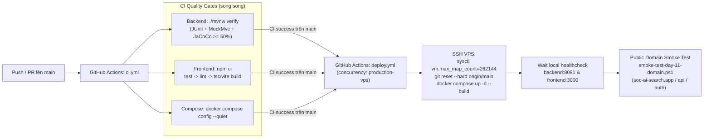

# Ngày 6: Logging (`MDC`), Error Handling, Testing (BE + FE), CI/CD Caddy & Tech Debt Self-Awareness

- **Thời lượng gợi ý:** 2.5 – 3 giờ
- **Tỷ trọng:** 70% Backend Cross-Cutting / Testing (JUnit, MockMvc, JaCoCo) / DevOps CI-CD & Tech Debt Audit • 30% Frontend Error Handling, Vitest & Nginx SPA Routing
- **Mục tiêu cuối ngày:** Hiểu sâu cách truy vết request bằng **Correlation ID (`MDC`)**, xử lý lỗi toàn cục, chiến lược kiểm thử cả Backend lẫn Frontend, quy trình deploy VPS tự động qua **GitHub Actions + Docker Compose + Caddy HTTPS**, và biến danh sách **Tech Debt thực tế** thành điểm cộng thể hiện tư duy kỹ sư trưởng thành.

---

## 1. Business Flow & Pipeline CI/CD → Production

---

## 2. Code Walkthrough Có Dẫn Đường (`BE + FE + Infra`)

### A. Tầng Backend: Tracing (`MDC`), Error Handling & Testing Gate (45%)
1. [CorrelationIdFilter.java](../../backend/src/main/java/com/soc/ai/search/common/logging/CorrelationIdFilter.java) (`@Order(Ordered.HIGHEST_PRECEDENCE)`)
   - Đọc header `X-Request-Id` từ client/proxy (cắt giới hạn tối đa 128 ký tự để chống log flooding/injection) hoặc tự sinh `UUID.randomUUID()`.
   - Đưa vào SLF4J `MDC.put("request_id", requestId)`, trả lại trong response header `X-Request-Id`, và **luôn gọi `MDC.remove(...)` trong `finally`**.
2. [RequestLoggingFilter.java](../../backend/src/main/java/com/soc/ai/search/common/logging/RequestLoggingFilter.java) (`@Order(Ordered.HIGHEST_PRECEDENCE + 1)`)
   - Ghi log metadata mỗi HTTP request: `request_id`, `query_id`, `user_identity`, `roles`, `method`, `path`, `status`, `latency_ms` — **tuyệt đối không log JWT hay payload raw log**.
   - **Điểm soi code cực sắc (Spring Filter Chain Order):** `RequestLoggingFilter` đặt `@Order(HIGHEST_PRECEDENCE + 1)` và gọi `putUserContext()` ở dòng 39 *trước* `filterChain.doFilter(...)`. Trong khi đó `SecurityFilterChain` chạy ở mức `-100` (sau filter này!). Nghĩa là với request xác thực bằng JWT, lúc dòng 39 chạy thì `SecurityContextHolder` chưa được điền — nên gọi `putUserContext()` ở đầu khối `finally` (hoặc đặt filter sau `SecurityFilterChain`) sẽ giúp `user_identity` và `roles` luôn xuất hiện đầy đủ trong log! (Một phát hiện code-level cực kỳ ấn tượng nếu nhắc tới khi phỏng vấn).
3. [GlobalApiExceptionHandler.java](../../backend/src/main/java/com/soc/ai/search/common/error/GlobalApiExceptionHandler.java) & [SecurityExceptionHandler.java](../../backend/src/main/java/com/soc/ai/search/security/SecurityExceptionHandler.java)
   - Ánh xạ ngoại lệ miền về HTTP status chuẩn: Validation/Unreadable → `400`, RateLimit → `429`, LLM failure → `502`, ES/PG dependency → `503`, Export NotFound → `404`, Export Conflict → `409`, AccessDenied → `403`.
   - `SearchErrorResponse` tự động gắn `request_id` từ `MDC` và `timestamp` UTC để người dùng gửi mã `request_id` cho kỹ sư tra cứu log nhanh.
4. [pom.xml](../../backend/pom.xml) (dòng 102–170)
   - Cấu hình **JaCoCo** loại trừ các DTO/Request/Response/Properties/Config/Exception để đo coverage thực chất trên **business logic** (Parser, Validator, Compiler, RBAC, Audit, Export, Summary), ép ngưỡng tối thiểu `INSTRUCTION COVEREDRATIO >= 0.50` trong pha `verify`.

### B. Tầng Frontend: Error Mapping, Vitest Testing & Nginx SPA Routing (30%)
5. [api-error-messages.ts](../../frontend/src/shared/services/api/api-error-messages.ts)
   - `toUiError(error)` gom mọi lỗi (`ApiError`, lỗi mạng `status: 0`, exception không mong muốn) về 1 cấu trúc `UiError` thống nhất, dịch `401` → *"Your session has expired. Please sign in again."* và `403` → *"You do not have permission to perform this action."* để UI không bị hiện raw stack/technical message khó hiểu.
6. **Chiến lược kiểm thử Frontend (Vitest + React Testing Library + JSDOM):**
   - Test tầng HTTP Client & 401 Retry: `api-client.test.ts` (mock `fetch`, verify single-flight refresh + retry đúng 1 lần).
   - Test tầng Security/Permissions: `permissions.test.ts`, `auth-gate.test.tsx`.
   - Test UI Flows & Edge Cases: `soc-dashboard.test.tsx` (verify auth gate & 401 handling), `query-transparency.test.tsx` (mock nặng `@uiw/react-codemirror` bằng `vi.mock` để test chạy nhanh, không dính lỗi DOM của CodeMirror trong JSDOM).
7. [nginx.conf](../../frontend/nginx.conf)
   - `location / { try_files $uri $uri/ /index.html; }` — đảm bảo khi user bấm F5 trên route SPA như `/dashboard` hay `/investigations`, Nginx trả về `index.html` cho React Router xử lý thay vì trả `404 Not Found`.

### C. Tầng DevOps & CI/CD (25%)
8. [Caddyfile](../../Caddyfile), [docker-compose.yml](../../docker-compose.yml), [ci.yml](../../.github/workflows/ci.yml), [deploy.yml](../../.github/workflows/deploy.yml)
   - **Caddy:** 11 dòng cấu hình định tuyến 3 subdomain (`soc-ai-search.app` → `frontend:80`, `api.soc-ai-search.app` → `backend:8080`, `auth.soc-ai-search.app` → `keycloak:8080`) kèm tự động cấp & gia hạn chứng chỉ HTTPS Let's Encrypt.
   - **CI (`ci.yml`):** Chạy 3 job song song (`backend`, `frontend`, `compose-config`) với `LLM_PROVIDER=mock` và `APP_AUTH_ENABLED=false` để test deterministic, nhanh và không phụ thuộc secret bên ngoài.
   - **CD (`deploy.yml`):** Chỉ chạy khi CI trên `main` pass (`workflow_run`), khóa `concurrency: group: production-vps` (`cancel-in-progress: false` để không cắt ngang giữa lúc container đang rebuild!), thiết lập `sysctl -w vm.max_map_count=262144` cho Elasticsearch, giữ lại `.env` và `generated-data/` khi `git clean`, chờ healthcheck backend/frontend xanh rồi chạy `smoke-test-day-11-domain.ps1`.

---

## 3. Ngân Hàng Câu Hỏi Phỏng Vấn & Câu Trả Lời Mẫu (10 Câu)

### Câu 1 (Backend Java / Concurrency): `MDC` trong `CorrelationIdFilter` hoạt động ra sao trong Tomcat servlet thread pool? Nếu quên dòng `MDC.remove(...)` trong `finally` thì hậu quả là gì?
- **Ý cốt lõi cần chạm:** SLF4J `MDC` lưu dữ liệu trên **`ThreadLocal`**; Tomcat tái sử dụng thread trong thread pool giữa các request khác nhau → quên xóa trong `finally` sẽ gây **context leak** (request B dùng lại thread cũ sẽ ghi nhầm `request_id` hoặc `user_identity` của request A!).
- **Câu trả lời mẫu (45s):**
  > "SLF4J `MDC` (Mapped Diagnostic Context) bản chất lưu một `Map` bên trong `ThreadLocal` gắn với luồng xử lý hiện tại, giúp mọi dòng log từ Controller xuống Service, Validator hay Repository đều tự động in kèm chung `request_id` mà không phải truyền tay qua tham số hàm. Tuy nhiên Tomcat sử dụng **thread pool** tái sử dụng lại luồng giữa nhiều HTTP request liên tiếp. Nếu không đặt `MDC.remove(LogFields.REQUEST_ID)` trong khối `finally`, khi request A gặp exception hoặc hoàn tất, thread đó quay về pool vẫn giữ nguyên `request_id` cũ — khiến request B kế tiếp có thể in lẫn `request_id` của request A và làm sai lệch toàn bộ việc điều tra log."
- **Follow-up trap:** *"Nếu sau này bạn tách AI Summary ra chạy bất đồng bộ trên `@Async` / `CompletableFuture` (một thread pool khác), `MDC` có tự động đi sang thread mới không?"*
  - **Hướng đáp:** Không! Vì `ThreadLocal` chỉ thuộc về thread tạo ra nó. Khi dùng `@Async` hay `ExecutorService`, cần cài **`TaskDecorator`** (trong Spring `ThreadPoolTaskExecutor`) để copy `MDC.getCopyOfContextMap()` từ thread cha sang thread con trước khi chạy và gọi `MDC.clear()` trong `finally` của thread con.

---

### Câu 2 (Backend Spring Filter Chain — Câu hỏi phân loại Senior!): Trong `RequestLoggingFilter.java`, bạn đặt `@Order(Ordered.HIGHEST_PRECEDENCE + 1)` và gọi `putUserContext()` trước `filterChain.doFilter()`. Điều gì sẽ xảy ra với `user_identity` trong log khi bật Keycloak Auth?
- **Ý cốt lõi cần chạm:** Hiểu thứ tự thực thi Filter Chain trong Spring Boot: `SecurityFilterChain` có order mặc định `-100`, chạy *sau* `HIGHEST_PRECEDENCE + 1` → lúc `putUserContext()` chạy thì `SecurityContextHolder` chưa có `JwtAuthenticationToken`; cách sửa là đọc `SecurityContextHolder` (hoặc truyền vào MDC) sau `doFilter` / đặt order filter sau SecurityFilterChain.
- **Câu trả lời mẫu (45s):**
  > "Đây là một chi tiết rất hay em phát hiện khi rà soát sâu Spring Filter Chain. `SecurityFilterChain` (nơi `BearerTokenAuthenticationFilter` giải mã JWT và điền `SecurityContextHolder`) có độ ưu tiên mặc định là `-100`, tức là chạy **sau** `@Order(Ordered.HIGHEST_PRECEDENCE + 1)`. Do đó khi `RequestLoggingFilter` gọi `putUserContext()` ở đầu `doFilterInternal`, `Authentication` vẫn là `null` đối với request mới đến (và khi `filterChain.doFilter` kết thúc ra tới `finally`, `SecurityContextHolderFilter` cũng đã dọn `SecurityContext`). Để `user_identity` và `roles` luôn lên đủ cả trong log của service lẫn log tổng kết HTTP, cách chuẩn là đặt một `OncePerRequestFilter` bổ sung chạy **sau** `BearerTokenAuthenticationFilter` bên trong `SecurityFilterChain` (hoặc gọi `addFilterAfter` trong `SecurityConfig`)."
- **Follow-up trap:** *"Tại sao `CorrelationIdFilter` vẫn nên giữ ở `Ordered.HIGHEST_PRECEDENCE` (trước cả Spring Security)?"*
  - **Hướng đáp:** Vì ngay cả khi request bị chặn ở Spring Security với lỗi `401 Unauthorized` hay `403 Forbidden`, ta vẫn cần có `X-Request-Id` trong response header và log để truy vết các cuộc tấn công brute-force/scan API trái phép!

---

### Câu 3 (Backend Testing & Quality Gate): Chiến lược kiểm thử Backend của bạn là gì? Tại sao CI dùng `MockLlmClient` và cấu hình JaCoCo loại trừ DTO/Config?
- **Ý cốt lõi cần chạm:** Tách biệt test deterministic khỏi sự bất định/chi phí/quota của cloud LLM; kiểm thử tập trung vào **hợp đồng an toàn** (Parser, Validator, Compiler, RBAC, CSV Injection, Audit); exclude DTO/boilerplate trong JaCoCo để tránh "coverage ảo".
- **Câu trả lời mẫu (45s):**
  > "Mục tiêu kiểm thử của em là bảo vệ những chỗ có rủi ro bảo mật và nghiệp vụ cao nhất: `SearchPlanJsonParserTest`, `SearchPlanValidatorTest`, `SearchPlanCompilerTest`, `RbacEndpointGuardTest`, `CsvRowWriterTest`, và `NaturalLanguageSearchServiceTest` (test cả nhánh repair và failure audit). Trong CI, em dùng `MockLlmClient` để bộ test chạy nhanh, hoàn toàn deterministic, không bị flaky do mạng và không đốt quota API key. Về JaCoCo, trong `pom.xml` em cố tình loại trừ các `record` DTO, `Config`, `Properties`, `Exception` khỏi mẫu số đo coverage — vì nếu để các lớp getter/boilerplate đó làm phồng chỉ số thì coverage nhìn rất cao nhưng thực tế logic lõi chưa được test kỹ. Ngưỡng 50% instruction gate trên phần business logic đảm bảo chất lượng thực chất hơn."
- **Follow-up trap:** *"Với các test phụ thuộc Elasticsearch và PostgreSQL (như kiểm tra mapping ES hay JPA `Specification` SQL thật trên Postgres), unit test với Mockito có đủ không?"*
  - **Hướng đáp:** Unit test + MockMvc rất nhanh cho logic và security guard, nhưng không bắt được lỗi cú pháp SQL/PostgreSQL JSONB hay lỗi tương thích phiên bản Elasticsearch 9.4. Hướng nâng cấp tốt nhất là bổ sung lớp **Integration Test dùng Testcontainers** (PostgreSQL + Elasticsearch container thật) chạy trong CI để kiểm chứng end-to-end từ JPA migration Flyway tới compiled ES DSL thật.

---

### Câu 4 (Security Testing): Làm sao bạn chứng minh bằng test tự động rằng phân quyền RBAC trên các controller không bị lỡ tay mở nhầm khi refactor?
- **Ý cốt lõi cần chạm:** `RbacEndpointGuardTest` và `SecurityConfigBusinessEndpointTest` dùng MockMvc + Spring Security Test kiểm chứng từng endpoint theo ma trận 4 vai trò (Anonymous → 401, `SOC_VIEWER` → 403 trên history/export/audit, `SOC_ANALYST` → 403 trên audit/ingest, `SOC_ADMIN` → 200), kết hợp `smoke-test-day-09-rbac.ps1` chạy thật với Keycloak.
- **Câu trả lời mẫu (40s):**
  > "Em không kiểm tra RBAC bằng tay mà khóa cứng bằng bộ test tự động hai tầng. Ở tầng unit/slice test, `RbacEndpointGuardTest` và `SecurityConfigBusinessEndpointTest` dùng `MockMvc` chạy qua `SecurityConfig` thật để khẳng định: request không token nhận `401`, `SOC_VIEWER` gọi `/api/v1/search/history` hay export CSV nhận `403`, `SOC_ANALYST` gọi `/api/v1/audit-logs` hoặc `/api/v1/events/bulk` nhận `403`, và chỉ `SOC_ADMIN` mới đi qua. Ở tầng tích hợp thật, em có script `smoke-test-day-09-rbac.ps1` lấy JWT thật từ Keycloak cho từng tài khoản mẫu để xác minh cấu hình realm và role mapper không bị lệch."
- **Follow-up trap:** *"Khi chạy test với `APP_AUTH_ENABLED=false` (mặc định local), làm sao đảm bảo test RBAC không vô tình pass giả vì auth bị tắt?"*
  - **Hướng đáp:** Các test bảo mật như `AuthControllerAuthEnabledTest` và `RbacEndpointGuardTest` ép tường minh cấu hình `app.auth.enabled=true` trong `@TestPropertySource` / `@SpringBootTest`, đồng thời test cả hai chế độ (`AuthDisabled` và `AuthEnabled`) để chắc chắn không có tình huống bypass nhầm khi bật auth.

---

### Câu 5 (DevOps — Caddy & Docker): Vì sao bạn chọn Caddy làm reverse proxy thay vì Nginx + Certbot? Và kiến trúc định tuyến từ người dùng vào hệ thống đi qua mấy lớp?
- **Ý cốt lõi cần chạm:** Caddy tự động cấp/gia hạn HTTPS Let's Encrypt không cần cronjob Certbot, cấu hình chỉ 11 dòng cực gọn và giảm sai sót; luồng `Browser → Caddy (443) → [frontend:80 (Nginx) | backend:8080 | keycloak:8080]`; chỉ mở public ports `22/80/443`.
- **Câu trả lời mẫu (40s):**
  > "Với mô hình deploy 3 subdomain (`soc-ai-search.app`, `api.soc-ai-search.app`, `auth.soc-ai-search.app`) trên một VPS, Nginx + Certbot đòi hỏi cấu hình nhiều block HTTP/HTTPS, ACME challenge và thiết lập gia hạn chứng chỉ thủ công dễ lỗi. Caddy tự động hóa hoàn toàn HTTPS/TLS (auto Let's Encrypt + HTTP→HTTPS redirect) chỉ trong 11 dòng `Caddyfile`. Trên VPS, chỉ có các port 22, 80, 443 được mở ra ngoài; toàn bộ PostgreSQL (5432), Elasticsearch (9200), Backend (8080), Keycloak (8080) chỉ giao tiếp qua mạng nội bộ Docker (hoặc bind `127.0.0.1`)."
- **Follow-up trap:** *"Khi hệ thống chạy production lớn hơn (nhiều node, cần WAF, rate limit ở edge, load balancing phức tạp), bạn có tiếp tục dùng một con Caddy trên 1 VPS không?"*
  - **Hướng đáp:** Lúc đó sẽ đặt lớp edge chuyên dụng hơn phía trước như Cloudflare / AWS ALB + WAF hoặc Kubernetes Ingress (Nginx/Envoy/Traefik) để chịu tải ngang (horizontal scaling), chống DDoS tầng L7 và tách certificate/secret quản lý tập trung.

---

### Câu 6 (DevOps — CI/CD & Linux Internals): Trong `.github/workflows/deploy.yml`, giải thích ý nghĩa của 3 chi tiết: `sysctl -w vm.max_map_count=262144`, `concurrency: cancel-in-progress: false`, và `smoke-test-day-11-domain.ps1`.
- **Ý cốt lõi cần chạm:** Elasticsearch dùng `mmap` ánh xạ file Lucene index vào bộ nhớ ảo nên mặc định Linux (`65530`) sẽ khiến ES crash lúc bootstrap check; `cancel-in-progress: false` tránh giết giữa chừng SSH deploy làm hệ thống ở trạng thái nửa vời; smoke test xác nhận end-to-end từ DNS/TLS/Caddy tới ứng dụng thật.
- **Câu trả lời mẫu (50s):**
  > "Thứ nhất, Elasticsearch sử dụng `mmapfs` để ánh xạ rất nhiều file Lucene index vào bộ nhớ ảo; giá trị `vm.max_map_count` mặc định trên Linux là 65.530 nên ES sẽ fail bootstrap check và không khởi động được nếu không nâng lên ít nhất `262144`. Thứ hai, `concurrency: group: production-vps` với `cancel-in-progress: false` đảm bảo tại một thời điểm chỉ có 1 job deploy chạy trên VPS và nếu có commit mới push lên giữa chừng, job sau sẽ xếp hàng chờ thay vì cắt ngang lệnh `docker compose up --build` đang chạy dở. Thứ ba, bước `smoke-test-day-11-domain.ps1` kiểm tra trực tiếp các domain public sau khi container local đã healthy — giúp phát hiện ngay các lỗi tầng mạng ngoài như sai DNS, chứng chỉ TLS Caddy lỗi hoặc CORS/reverse proxy hỏng."
- **Follow-up trap:** *"Cách deploy bằng `git reset --hard` + `docker compose up -d --build` trực tiếp trên VPS có nhược điểm gì?"*
  - **Hướng đáp:** Có 3 nhược điểm: (1) tốn CPU/RAM build Java + Vite ngay trên VPS production (có thể ảnh hưởng ES đang chạy), (2) có downtime ngắn khi container backend khởi động lại, và (3) khó rollback nhanh về bản trước. Cách chuẩn production là **build Docker image trên GitHub Actions, push lên Container Registry (GHCR) gắn tag commit SHA**, VPS chỉ `docker compose pull` và hỗ trợ blue-green/rolling update để zero-downtime và rollback tức thì theo image tag.

---

### Câu 7 (Frontend — Nginx SPA Routing): Trong `frontend/nginx.conf`, dòng `try_files $uri $uri/ /index.html;` có tác dụng gì? Nếu thiếu dòng này thì chuyện gì xảy ra khi user bấm F5 tại `/dashboard`?
- **Ý cốt lõi cần chạm:** React Router dùng History API (client-side routing); trình duyệt bấm F5 sẽ gửi HTTP `GET /dashboard` lên Nginx, nhưng trên ổ đĩa không có file `/usr/share/nginx/html/dashboard` → thiếu `try_files` sẽ bị `404 Not Found`.
- **Câu trả lời mẫu (35s):**
  > "Vì React Router quản lý các đường dẫn `/dashboard`, `/search`, `/investigations` hoàn toàn ở phía trình duyệt, khi người dùng chuyển trang bằng click link thì trình duyệt không tải lại server. Nhưng nếu người dùng bấm F5 hoặc dán thẳng URL `https://soc-ai-search.app/dashboard`, trình duyệt sẽ gửi yêu cầu `GET /dashboard` tới container Nginx của frontend. Trên thư mục static build chỉ có `index.html` và thư mục `assets/`, không hề có file `dashboard`. Chỉ thị `try_files $uri $uri/ /index.html;` bảo Nginx trả về `index.html` làm fallback để React tải lên và khớp đúng route `/dashboard`."
- **Follow-up trap:** *"Vậy làm sao tránh trường hợp trình duyệt cache cũ file `index.html` sau khi bạn vừa deploy phiên bản mới?"*
  - **Hướng đáp:** Vite tự gắn content hash vào tên file JS/CSS trong `assets/` (ví dụ `index-Ab3x9Z.js`) nên các file asset có thể đặt `Cache-Control: public, max-age=31536000, immutable`, còn riêng `index.html` nên cấu hình `Cache-Control: no-cache` trong `nginx.conf` để trình duyệt luôn kiểm tra bản `index.html` mới nhất sau mỗi lần deploy.

---

### Câu 8 (Frontend — Error UX & Resilience): Giải thích kiến trúc chuẩn hóa lỗi trên Frontend từ `http-client.ts` → `ApiError` → `api-error-messages.ts` (`toUiError`).
- **Ý cốt lõi cần chạm:** Một chuẩn `ApiError` duy nhất cho cả HTTP lỗi (4xx/5xx) lẫn network error (`status: 0`), giữ tách biệt lỗi `AbortError` (không coi là lỗi hiển thị UI), và dịch thông điệp thân thiện tại `toUiError`.
- **Câu trả lời mẫu (35s):**
  > "Thay vì để từng component tự `try/catch` đọc raw `Response` hay chuỗi lỗi kỹ thuật khác nhau, `http-client.ts` chuẩn hóa mọi lỗi thành đối tượng `ApiError` gồm `status`, `message`, `errors` (lỗi mất mạng gán `status: 0`, còn `AbortError` do hủy request có chủ đích thì ném nguyên ra để hook bỏ qua êm). Sau đó tầng UI gọi `toUiError(error)` trong `api-error-messages.ts` để ánh xạ tập trung các mã đặc thù như `401` (phiên hết hạn), `403` (không đủ quyền) hay lỗi client bất ngờ sang cấu trúc `UiError` nhất quán cho toàn bộ các trang."
- **Follow-up trap:** *"Nếu server trả 500 kèm trang HTML lỗi từ reverse proxy (không phải JSON), `http-client.ts` có bị crash ở lệnh `await response.json()` không?"*
  - **Hướng đáp:** Không! Trong `http-client.ts` dòng 61–64, code kiểm tra `contentType.includes('application/json')` trước khi gọi `response.json()`; nếu là HTML/text thì `payload = null` và `errorPayload(null)` vẫn trả về thông báo lỗi mặc định an toàn thay vì nổ `SyntaxError`.

---

### Câu 9 (Frontend Testing): Trong `query-transparency.test.tsx` hay `api-client.test.ts`, chiến lược viết test Frontend bằng Vitest & React Testing Library của bạn tập trung kiểm chứng điều gì?
- **Ý cốt lõi cần chạm:** Test theo **hành vi người dùng & hợp đồng logic** (không test chi tiết implementation CSS nội bộ), mock các dependency nặng không phù hợp JSDOM (như CodeMirror) và mock `fetch`/OIDC để test các ca khó tái hiện như race condition `401` retry.
- **Câu trả lời mẫu (40s):**
  > "Với Frontend, em tránh test những chi tiết dễ gãy như tên class Tailwind mà tập trung vào **hành vi cốt lõi và rủi ro cao**: (1) `api-client.test.ts` giả lập `fetch` trả `401` đồng thời để chứng minh cơ chế single-flight `refreshTokenOnce` chỉ gọi refresh 1 lần rồi retry thành công; (2) `permissions.test.ts` và `soc-dashboard.test.tsx` kiểm tra chặt ma trận quyền và auth gate; (3) các component test dùng React Testing Library truy vấn theo role/label gần với thao tác người dùng, đồng thời dùng `vi.mock` thay thế các thư viện editor nặng như `@uiw/react-codemirror` trong JSDOM để bộ test chạy nhanh trong vài giây trên CI."
- **Follow-up trap:** *"Unit/component test với Vitest + JSDOM không bắt được loại lỗi nào mà phải cần thêm E2E test (Playwright/Cypress)?"*
  - **Hướng đáp:** JSDOM không chạy trình duyệt thật nên không phát hiện được lỗi layout CSS thực tế, lỗi CORS cross-origin thật giữa 3 subdomain, luồng redirect OIDC thật qua trang đăng nhập Keycloak, hay hành vi tải file Blob thật của trình duyệt. Đó là lý do ở production nên bổ sung thêm 3–5 luồng **Playwright E2E critical paths**.

---

### Câu 10 (Câu hỏi "ăn điểm Senior" — Tech Debt Self-Awareness): Nếu bạn có thêm 2 tuần để refactor và hoàn thiện đồ án này trước khi đưa vào vận hành thật, bạn sẽ ưu tiên làm gì trước?
- **Ý cốt lõi cần chạm:** Trả lời trung thực, có dẫn chứng trực tiếp từ codebase thật (chứng minh bạn làm chủ 100% dự án) và biết xếp thứ tự ưu tiên theo tác động rủi ro (Security/Reliability → Correctness/Standards → Scale/Observability).
- **Câu trả lời mẫu (60s):**
  > "Em đã tự rà soát lại toàn bộ codebase và chia ưu tiên thành 3 nhóm rõ ràng. **Ưu tiên 1 — Bảo mật & Ổn định vận hành:** (a) bổ sung **Rate Limiting** (Bucket4j/Redis theo `user_identity` và role) cho các endpoint LLM để chống spam đốt quota; (b) đóng khe hở `audit=false` trên `/api/v1/search/plan` bằng cách tách riêng endpoint Dashboard cố định; (c) đưa 2 hàm CSV export trên FE đi qua `http-client.ts` (`requestBlob`) để có đủ cơ chế 401 refresh-and-retry, đồng thời bổ sung `@ExceptionHandler` cho `EventIngestException` và fallback `Exception.class` trên BE. **Ưu tiên 2 — Hiệu năng & Scale:** tách AI Summary sang luồng bất đồng bộ (giảm Time-to-First-Result), thêm cache TTL 30–60s cho Dashboard, thay Painless sort `severity` bằng index-time `severity_rank`, và nâng cấp CSV Export từ `from+size` lên `PIT + search_after`. **Ưu tiên 3 — Observability & Chuẩn hóa:** gắn Spring Boot Actuator + Micrometer đo trực tiếp `llm_parse_failure_rate` và `summary_fallback_rate`, tách `SearchPlanExecutionService` khỏi `SearchController`, sửa encoding mojibake tiếng Việt trong `SearchPlanPromptBuilder`, và gom nhất quán về 1 `ApiErrorResponse` + Prettier/LF."
- **Follow-up trap:** *"Tại sao bạn xếp Rate Limiting và Observability lên trước việc làm thêm tính năng mới như Multi-turn chat?"*
  - **Hướng đáp:** Vì với hệ thống tích hợp LLM ở môi trường SOC, không có Rate Limit thì 1 tài khoản bị lộ hoặc script lỗi có thể đốt sạch quota API trong vài phút, và không có Metrics/Observability thì khi triển khai thêm tính năng phức tạp như Multi-turn chat ta sẽ bị "mù", không đo được độ chính xác, tỷ lệ fallback hay độ trễ tăng bao nhiêu.

---

## 4. Self-Check Cuối Ngày 6 (15 Phút — Đóng Tài Liệu Lại)

- [ ] Giải thích chính xác vì sao `MDC.remove()` bắt buộc nằm trong `finally` và phát hiện về thứ tự `RequestLoggingFilter` vs `SecurityFilterChain`.
- [ ] Nêu được chiến lược test BE (JaCoCo business logic gate, `MockLlmClient`, `RbacEndpointGuardTest`) và FE (Vitest + Testing Library + `vi.mock`).
- [ ] Giải thích rõ 3 điểm trong CI/CD & Nginx: `try_files ... /index.html`, `vm.max_map_count=262144`, `concurrency: cancel-in-progress: false`.
- [ ] Thuộc danh sách **Top 5 Tech Debt & Ưu tiên nâng cấp** để trả lời tự tin câu *"Nếu làm lại/nâng cấp em sẽ sửa gì?"*.
